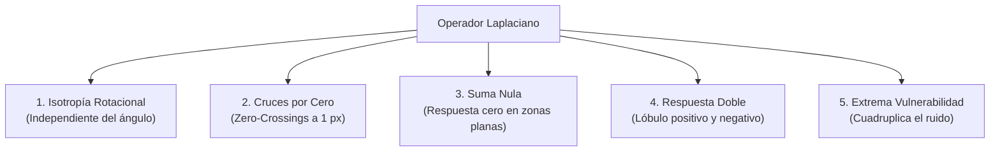

# Clase 13 — Operador Laplaciano, Cruces por Cero y Filtro LoG

> [!info] Fecha
> 📅 Martes, 20 de octubre de 2026 — Semana 10

## 📝 Temas vistos

1. **La Segunda Derivada en el Espacio Discreto (Operador Laplaciano $\nabla^2 f$):**
   - Transición del Gradiente (vector 2D) al Laplaciano (escalar isotrópico): ya no calculamos dos matrices direccionales ($G_x, G_y$), sino un **único valor escalar** por píxel que mide la curvatura local de intensidad.
   - Suma de derivadas de segundo orden ortogonales:
     $$ \nabla^2 f = \frac{\partial^2 f}{\partial x^2} + \frac{\partial^2 f}{\partial y^2} $$
   - **Condición de neutralidad en áreas planas:** La suma de los coeficientes del kernel debe ser exactamente **cero** ($\sum w_i = 0$), garantizando respuesta nula ante iluminación uniforme.
2. **Máscaras Convolucionales de 4 y 8 Vecinos:**
   - Máscara de 4-vecinos (cruz) y 8-vecinos (completa con diagonales).
3. **Propiedades Fundamentales del Laplaciano:**
   - **Isotropía (Invarianza rotacional):** Detecta bordes en cualquier dirección angular sin necesidad de calcular ángulos trigonométricos.
   - **Cruces por Cero (*Zero-Crossings*):** Los bordes reales no son picos máximos, sino el punto exacto donde la señal cruza el cero ($+ \leftrightarrow -$), produciendo contornos cerrados de $1$ píxel de grosor.
   - **Sensibilidad Extrema al Ruido:** Como operador de segundo orden, amplifica cuadráticamente las altas frecuencias ($\omega^2$) y multiplica cualquier perturbación aislada por $-4$ o $-8$.
4. **Filtro Laplaciano del Gaussiano (LoG / *Marr-Hildreth* / Sombrero Mexicano):**
   - ¿Cómo blindar al Laplaciano del ruido? Suavizar primero con una Gaussiana y derivar después.
   - Por la propiedad conmutativa y asociativa de la convolución:
     $$ \nabla^2 [f * G_\sigma] = [\nabla^2 G_\sigma] * f $$
   - En lugar de dos pasos costosos, se convoluciona directamente con el kernel analítico del **Sombrero Mexicano (*Mexican Hat*)**.
5. **Debate de Ingeniería — Caso Entorno Extremo:**
   - Análisis de diseño de un sistema de visión para un **ecógrafo portátil de bajo costo** (sensor con altísimo ruido de alta frecuencia / *speckle*): ¿Gradiente (Sobel) o Segunda Derivada (Laplaciano)?

---

## 🧮 1. El Operador Laplaciano en el Espacio Discreto

A partir de las diferencias finitas de segundo orden en 1D:
$$ \frac{\partial^2 f}{\partial x^2} \approx f(x+1, y) - 2f(x, y) + f(x-1, y) $$
$$ \frac{\partial^2 f}{\partial y^2} \approx f(x, y+1) - 2f(x, y) + f(x, y-1) $$

Sumando ambas componentes en 2D:
$$ \nabla^2 f(x, y) = f(x+1, y) + f(x-1, y) + f(x, y+1) + f(x, y-1) - 4f(x, y) $$

### Máscaras Convolucionales $3 \times 3$

Dependiendo de si se toma el píxel central como negativo o positivo:

#### Configuración A: Centro Negativo (Tradicional en Visión)
```text
      Vecindad-4 (Cruz)               Vecindad-8 (Completa)
        [ 0   1   0 ]                    [ 1   1   1 ]
    K = [ 1  -4   1 ]                K = [ 1  -8   1 ]
        [ 0   1   0 ]                    [ 1   1   1 ]
    (Suma coeficientes = 0)          (Suma coeficientes = 0)
```

#### Configuración B: Centro Positivo (Signos Invertidos)
```text
      Vecindad-4 (Cruz)               Vecindad-8 (Completa)
        [  0  -1   0 ]                   [ -1  -1  -1 ]
    K = [ -1   4  -1 ]               K = [ -1   8  -1 ]
        [  0  -1   0 ]                   [ -1  -1  -1 ]
```

> [!important] ¿Por qué la suma de coeficientes DEBE ser cero?
> Si una zona de la imagen tiene intensidad constante $C$ (ej. una pared o el fondo de una banda), el operador debe entregar $0$:
> $$ \sum w_i \cdot C = C \sum w_i = C \cdot 0 = 0 $$
> De lo contrario, las zonas homogéneas se verían afectadas por el nivel de brillo general.

---

## 🔬 2. Las 5 Propiedades Clave del Laplaciano



1. **Isotropía (Invarianza Rotacional):**
   - El Laplaciano es un operador escalar simétrico. Responde con idéntica magnitud sin importar si el borde es horizontal, vertical o diagonal a $37.5^\circ$. No requiere calcular componentes direccionales ni arcotangentes.
2. **Cruces por Cero (*Zero-Crossings*):**
   - En una rampa o escalón de intensidad, la 1.ª derivada genera una joroba ancha.
   - La 2.ª derivada produce un **pico positivo** al iniciar la transición y un **pico negativo** al terminarla.
   - El contorno verdadero está exactamente en el **cruce por cero** entre ambos picos, generando bordes delgados de exactamente **1 píxel de espesor**.
3. **Respuesta Doble:**
   - Para cualquier discontinuidad, produce dos líneas paralelas (un halo claro y un halo oscuro).
4. **Suma de Pesos Nula ($\sum w_i = 0$):**
   - Inmune al nivel absoluto de brillo continuo (DC bias).
5. **Vulnerabilidad Crítica ante Ruido:**
   - Como operador de segunda derivada, **multiplica los impulsos de ruido por $-4$ o $-8$** y eleva la frecuencia al cuadrado ($\omega^2$).

---

## 🛡️ 3. El Filtro Laplaciano del Gaussiano (LoG)

> [!danger] La Metáfora de la Ropa Húmeda
> "Si tienes una chaqueta húmeda y la vuelves a mojar, queda empapada". Con las derivadas ocurre lo mismo:
> Si una imagen tiene ruido, la **primera derivada lo amplifica**; si le aplicas una **segunda derivada, lo sobreamplifica de forma incontrolable**.

Para resolver este problema, **David Marr y Ellen Hildreth (1980)** propusieron el filtro **LoG (*Laplacian of Gaussian*)**:
1. **Paso 1:** Suavizar con filtro Gaussiano $G_\sigma(x, y)$ para suprimir altas frecuencias de ruido.
2. **Paso 2:** Aplicar el Laplaciano $\nabla^2$ sobre la imagen limpia.

### La Magia de la Conmutatividad:
Dado que la convolución y la derivación son operaciones lineales e invariantes en el desplazamiento:
$$ \nabla^2 [f(x, y) * G_\sigma(x, y)] = [\nabla^2 G_\sigma(x, y)] * f(x, y) $$

¡No es necesario hacer dos convoluciones! Se deriva analíticamente la función Gaussiana continua para obtener el **Kernel del Sombrero Mexicano (*Mexican Hat*)**:

$$ \text{LoG}(x, y) = -\frac{1}{\pi \sigma^4} \left( 1 - \frac{x^2 + y^2}{2\sigma^2} \right) e^{-\frac{x^2 + y^2}{2\sigma^2}} $$

```text
Perfil 1D del Sombrero Mexicano (LoG):
             +---+  (Lóbulo positivo central)
            /     \
    -------+       +-------  (Cruces por cero)
   /                       \
  +                         + (Valles negativos laterales)
```

---

## 🩺 4. Análisis de Caso: Entorno Extremo en Ingeniería Biomédica

> [!question] Reto de Clase
> Eres el ingeniero principal diseñando el sistema de visión por computador para un **ecógrafo portátil de bajo costo**. El transductor acústico piezoeléctrico genera un **altísimo nivel de ruido de alta frecuencia (*speckle noise*)** y ruido térmico.
>
> **¿Diseñas el detector de contornos de órganos basándote en el Gradiente (Sobel) o en la Segunda Derivada (Laplaciano)?**
> **¿Por qué tomas esa decisión y qué precauciones tomas con el parámetro de dirección $\theta$ o escala?**

### 🎯 Decisión de Ingeniería: **GRADIENTE (Sobel / Canny) — NUNCA Laplaciano Puro**

#### 1. ¿Por qué es inadmisible usar el Laplaciano puro?
* **Multiplicación catastrófica del *Speckle*:** Las ecografías están dominadas por el ruido de moteado acústico (*speckle*), un fenómeno de interferencia destructiva de alta frecuencia. Aplicar el Laplaciano puro ($[-4]$ o $[-8]$ en el centro con respuesta $\omega^2$) detonaría el piso de ruido.
* **Proliferación de Falsos Cruces por Cero (*Spurious Zero-Crossings*):** Cada grano microscópico de speckle generaría un par de picos $+/-$ y un cruce por cero falso. La pantalla se llenaría de miles de falsos contornos espurios ("telaraña de ruido"), ocultando la verdadera pared del órgano e induciendo diagnósticos médicos erróneos mortales (ej. diagnosticar una falsa perforación o masa tumoral inexistente).
* **Bordes de órganos difusos:** Las interfaces entre tejidos orgánicos no son escalones metálicos; son transiciones acústicas suaves (rampas). El Laplaciano produce señales muy débiles en rampas, siendo incapaz de separarlas del ruido amplificado.

#### 2. ¿Por qué el Gradiente (Sobel) es la opción correcta?
* **Sensibilidad Moderada:** Solo deriva una vez (crecimiento lineal con la frecuencia $\omega$).
* **Filtro Gaussiano integrado $[1, 2, 1]^T$:** Sobel ya suaviza en la dirección perpendicular mientras deriva, conteniendo la dispersión del speckle.
* **Umbralización continua:** Permite definir un umbral sobre la magnitud $M = \sqrt{G_x^2 + G_y^2}$ para descartar de golpe las fluctuaciones del fondo.

#### 3. Precauciones con el Parámetro $\theta$ (Dirección del Gradiente):
* **Filtro de Coherencia Anatómica:** En un órgano (ej. pared del ventrículo izquierdo o cápsula renal), el contorno real tiene una curvatura suave y continua. Se debe usar el ángulo $\theta = \arctan(G_y / G_x)$ para:
  1. **Enlazar bordes coherentes:** Aceptar únicamente píxeles donde la orientación del gradiente sea tangente a la pared esperada del órgano.
  2. **Rechazar el speckle:** El ruido aleatorio produce ángulos $\theta$ caóticos e incoherentes entre píxeles vecinos adyacentes. Si el ángulo salta bruscamente de $10^\circ$ a $160^\circ$ en un píxel adyacente, se descarta como ruido.
* **Precaución adicional en Escala ($\sigma$):** Antes de calcular el gradiente, es obligatorio aplicar un filtro Gaussiano o un filtro adaptativo de speckle (tipo Lee o Frost) con un $\sigma$ generoso ($\sigma \ge 2.5 - 3.5$) para suprimir el grano acústico antes de la derivación.

---

## 🔗 Relacionado

- [[Operador Laplaciano y Cruces por Cero]] — concepto atómico del operador de 2da derivada
- [[Filtro Laplaciano del Gaussiano - LoG]] — formulación analítica del sombrero mexicano
- [[Operador Laplaciano y Filtro LoG - Python]] — implementación práctica con OpenCV
- [[Operadores de Gradiente - Roberts, Prewitt y Sobel]] — comparativa con operadores de 1ra derivada
- [[Derivadas Espaciales en Imágenes]] — teoría de diferencias finitas 1D y 2D
- [[Inicio]] — índice general de la materia
