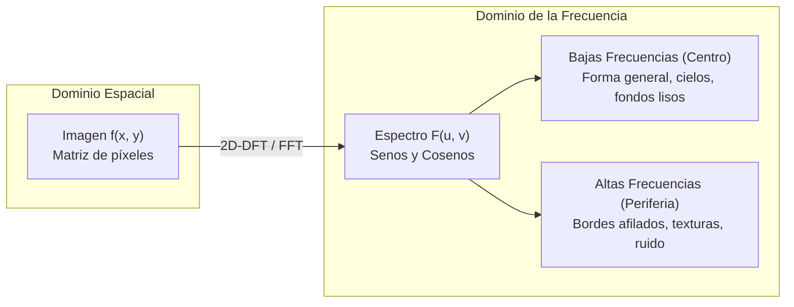
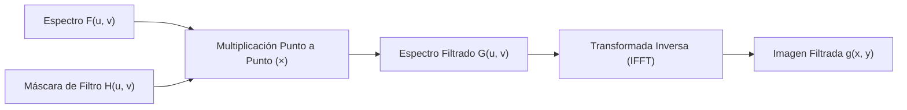

# Clase 14 — Unidad 3: Introducción al Dominio de la Frecuencia y Transformada de Fourier

> [!info] Inicio de la Unidad 3
> 📅 Miércoles, 21 de octubre de 2026 — Semana 10  
> 🎯 **Objetivo de la Unidad:** Cambiar radicalmente la perspectiva de análisis. Dejamos de ver la imagen como una cuadrícula de píxeles espaciales $f(x, y)$ y aprendemos a verla como un **acorde de frecuencias espaciales** mediante la Transformada de Fourier.

---

## 📝 Temas vistos

1. **Cambio de Paradigma: Dominio Espacial vs. Dominio de la Frecuencia:**
   - La analogía del acorde musical: Una pieza sonora no se entiende analizando la presión del aire milisegundo a milisegundo, sino identificando las notas puras (frecuencias) que la componen.
   - En una imagen:
     - **Bajas Frecuencias:** Zonas homogéneas, transiciones lentas y suaves de iluminación, fondos lisos y la forma macroscópica.
     - **Altas Frecuencias:** Transiciones bruscas, bordes afilados, detalles finos, microtexturas y ruido.
2. **De la Serie de Fourier a la Transformada de Fourier:**
   - **Serie de Fourier:** Descomposición de señales periódicas infinitas continuas en sumas ponderadas de senos y cosenos armónicos ($\omega_0 = 2\pi / T$).
   - **El enigma de la Onda Cuadrada resuelto:** Cómo la suma de armónicos sinusoidales suaves construye bordes perfectamente afilados y discontinuidades tipo escalón.
   - **Paso a la Transformada Discreta de Fourier (2D-DFT):** Adaptación matemática para imágenes digitales finitas y no periódicas.
3. **Visualización del Espectro y Compresión Logarítmica:**
   - Por qué el ojo humano solo ve un punto central blanco sin transformar: La colosal concentración de energía en el componente DC ($F(0,0)$).
   - Solución obligatoria: Escala logarítmica $D(u, v) = c \cdot \log(1 + |F(u, v)|)$.
   - Centrado del espectro (`fftshift`) para colocar las bajas frecuencias en el centro.
4. **Magnitud vs. Fase: El "Cuánto" vs. el "Dónde":**
   - **Magnitud ($|F(u, v)|$):** Contiene la información de *cuánto* hay de cada frecuencia (energía, contraste, textura).
   - **Fase ($\phi(u, v)$):** Contiene la información de *dónde* ocurren los cambios (ubicación geométrica exacta de los bordes y coherencia estructural).
   - **La regla de oro:** Perder o alterar la fase destruye por completo el reconocimiento visual de la imagen.
5. **Filtrado en el Dominio de la Frecuencia:**
   - Teorema de la Convolución: $f(x, y) * h(x, y) \longleftrightarrow F(u, v) \cdot H(u, v)$.
   - **Filtros Pasa-Bajas (LPF):** Suavizado y difuminado (*blur*).
   - **Filtros Pasa-Altas (HPF):** Extracción y realce de bordes (ej. desaparecer el cielo azul continuo y conservar las casas).
   - **Filtros Notch / Muesca:** Erradicación selectiva de **ruido periódico** (patrones sinusoidales de interferencia).

---

## 🎶 1. Las Gafas de Fourier: La Imagen como un Acorde Musical



Fourier nos entrega un prisma matemático:
* Si una imagen es un **cielo azul completamente despejado o una pared plana**, los píxeles apenas cambian $\to$ la imagen está compuesta casi exclusivamente por **bajas frecuencias**.
* Si una imagen tiene **muchos objetos, tuercas, letras o texturas rugosas**, la intensidad salta violentamente de un píxel a otro $\to$ contiene una gran riqueza de **altas frecuencias**.

---

## 🔲 2. ¿De dónde salió la Onda Cuadrada y por qué es crucial?

> [!question] La Duda Común: ¿Por qué el profesor explicó una onda cuadrada si estamos viendo imágenes?
> Porque la onda cuadrada es la demostración matemática perfecta de **cómo se construye un borde afilado en visión artificial**.

Una onda cuadrada periódica con período $T$ y amplitud $A$ representa una transición abrupta entre dos valores constantes (equivalente a una franja blanca sobre fondo negro, es decir, dos bordes de tipo escalón perfecto).

Jean-Baptiste Fourier demostró que esa forma con esquinas rectas se puede sintetizar sumando únicamente ondas sinusoidales puras (armónicos impares):

$$ f(t) = \frac{4A}{\pi} \left( \sin(\omega_0 t) + \frac{1}{3}\sin(3\omega_0 t) + \frac{1}{5}\sin(5\omega_0 t) + \frac{1}{7}\sin(7\omega_0 t) + \dots \right) $$

```text
Armónico 1 (Fundamental):   ~~~/\~~~/\~~~       (Onda suave, forma general)
+ Armónico 3 (3ω):          Mundea los picos
+ Armónicos 5, 7, 9...:     Aplana la cima y verticaliza las paredes
= Con N armónicos:          |¯¯¯|___|¯¯¯|___|   (Onda Cuadrada / Borde Recto)
```

### La lección para Visión Artificial:
1. **El primer armónico ($\omega_0$)** aporta la energía gruesa y la forma general del objeto.
2. **Los armónicos superiores ($3\omega, 5\omega, \dots$)** aportan los coeficientes $b_n = \frac{4A}{n\pi}$ que verticalizan las pendientes y construyen las **esquinas afiladas**.
3. A medida que $n$ crece, el coeficiente $b_n$ decae como $1/n$ (cada armónico sucesivo aporta menos energía pero mayor agudeza geométrica).
4. **Conclusión:** Si eliminas las frecuencias altas de una imagen, las esquinas se redondean y los bordes se vuelven borrosos. Si eliminas las bajas frecuencias, desaparece la masa del objeto y solo sobreviven las aristas.

---

## 📊 3. Visualización del Espectro: La Escala Logarítmica Obligatoria

En la Transformada Discreta de Fourier 2D (2D-DFT), el valor en el origen $(u=0, v=0)$ se conoce como el **Componente DC**:
$$ F(0, 0) = \sum_{x=0}^{M-1} \sum_{y=0}^{N-1} f(x, y) = M \times N \times \bar{f} $$
Es igual a la suma total de todos los píxeles de la imagen (proporcional al brillo promedio).

* **El problema visual:** Si una imagen de $512 \times 512$ tiene brillo promedio $128$, $F(0, 0) \approx 3.3 \times 10^7$, mientras que las frecuencias de borde pueden valer $10$ o $100$.
* Si proyectas esto en una pantalla lineal de $0$ a $255$:
  - El píxel central satura a $255$ (blanco puro).
  - El resto de los píxeles valen menos de $1$ (negro absoluto).
  - **Resultado:** El ojo humano solo vería un único punto blanco solitario en una pantalla negra.
* **La solución:** Aplicar una transformación logarítmica para comprimir el rango dinámico:
  $$ D(u, v) = c \cdot \log(1 + |F(u, v)|) $$

> [!tip] El Centrado Espectral (`fftshift`)
> Por defecto, la FFT ubica las frecuencias bajas en las cuatro esquinas de la matriz. Para que el espectro sea intuitivo de analizar y filtrar, se utiliza `np.fft.fftshift()`, que intercambia los cuadrantes para ubicar el componente DC $(0, 0)$ en el centro exacto.

---

## 🧠 4. Magnitud vs. Fase: El "Cuánto" vs. el "Dónde"

Toda celda del espectro complejo $F(u, v) = R(u, v) + j I(u, v)$ se descompone en forma polar:
$$ F(u, v) = |F(u, v)| e^{j \phi(u, v)} $$

| Componente | Fórmula | Significado Físico en la Imagen | Metáfora del Estudiante |
| :--- | :---: | :--- | :--- |
| **Magnitud $|F(u, v)|$** | $\sqrt{R^2 + I^2}$ | **El "Cuánto":** Indica qué frecuencias están presentes, con qué contraste y energía general, y la orientación dominante de las texturas. | "La cámara de fotos" (el objeto en sí). |
| **Fase $\phi(u, v)$** | $\arctan\left(\frac{I}{R}\right)$ | **El "Dónde":** Indica la posición espacial relativa de cada onda sinusoidal para construir los bordes y esquinas en su coordenada correcta. | "La coordenada (10, 10) del aula de informática". |

### ⚠️ El Experimento Crucial de Reconstrucción Cruzada:
Si tomas la **Magnitud de la imagen de un Gato** y la combinas con la **Fase de la imagen de un Perro**, y calculas la Transformada Inversa:
* **Resultado:** ¡Ves al **Perro**! (con un leve matiz de brillo o textura del gato).
* **Conclusión:** **La fase contiene la estructura geométrica inteligible de la escena.** Si destruyes la fase de una imagen, esta se vuelve una sopa de ruido completamente irreconocible.

---

## 🎛️ 5. Filtrado en Frecuencia: Pasa-Bajas, Pasa-Altas y Ruido Periódico

El filtrado en frecuencia se rige por el **Teorema de la Convolución**:
$$ g(x, y) = \mathcal{F}^{-1}\{ F(u, v) \cdot H(u, v) \} $$
Una convolución espacial que requeriría millones de operaciones se convierte en una simple **multiplicación punto a punto** de matrices complejas.



### 1. Filtro Pasa-Bajas (*Low-Pass Filter* - LPF):
* Máscara: $H(u, v) = 1$ en el centro (bajas frecuencias) y $0$ en la periferia.
* **Efecto:** Suprime los detalles finos y las aristas vivas $\to$ produce un **suavizado o desenfoque (*blur*)**.

### 2. Filtro Pasa-Altas (*High-Pass Filter* - HPF):
* Máscara: $H(u, v) = 0$ en el centro y $1$ en la periferia.
* **Efecto:** Suprime las componentes homogéneas constantes y deja pasar solo los saltos bruscos.
* *El ejemplo del cielo azul:* En una imagen de casas bajo un cielo azul despejado, el cielo es una baja frecuencia plana. Al aplicar un pasa-altas, el cielo se vuelve completamente negro (desaparece) y solo resaltan los bordes y contornos de las casas.

### 3. Filtros Notch (Muesca) y Eliminación de Ruido Periódico:
* Cuando una cámara sufre interferencia eléctrica (ej. $60\text{ Hz}$ de la red o líneas de escáner), el ruido no es aleatorio: es una onda sinusoidal que se repite rítmicamente en toda la imagen.
* En el dominio espacial es casi imposible de eliminar con filtros de convolución pequeños sin destrozar la imagen.
* En el espectro de Fourier, esa interferencia se concentra en **dos puntos brillantes simétricos fuera del centro**.
* **Solución:** Multiplicar por una máscara que valga $1$ en todas partes excepto en esos dos puntos específicos (donde vale $0$). ¡El ruido periódico desaparece como por arte de magia sin alterar el resto de la imagen!

---

## 🔗 Relacionado

- [[Dominio de la Frecuencia y Transformada de Fourier]] — fundamentos teóricos de la 2D-DFT
- [[Magnitud y Fase en Fourier]] — el dilema geométrico y reconstructivo
- [[Filtrado en el Dominio de la Frecuencia]] — filtros LPF, HPF, Butterworth y Notch
- [[Transformada de Fourier y Filtrado en Frecuencia - Python]] — código ejecutable con NumPy y OpenCV
- [[Inicio]] — mapa general de la bóveda
