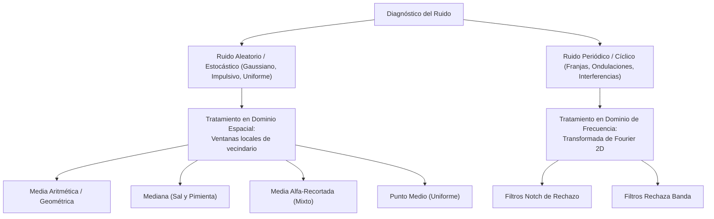
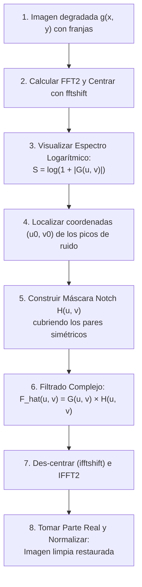

# Clase 15 — Unidad 4: Reducción de Ruido Aditivo y Cíclico

> [!info] Fecha y Contexto
> 📅 Miércoles, 28 de octubre de 2026 — Semana 11  
> 📖 Basado en las diapositivas «4.3 Reducción de Ruido Aditivo y Cíclico», Unidad 4: Filtrado en el dominio de la frecuencia.

---

## 🎯 Idea Principal: Identificar el Ruido Antes de Filtrar

> [!important] Regla de Oro del Procesamiento
> **No existe un filtro universal.** Antes de aplicar cualquier algoritmo, se debe diagnosticar la naturaleza matemática del ruido para seleccionar el método que lo atenúe sin destruir los detalles y bordes útiles de la escena.

$$\text{Modelo Aditivo General:} \quad g(x, y) = f(x, y) + \eta(x, y)$$

donde $g(x, y)$ es la imagen degradada observada, $f(x, y)$ la imagen pura ideal y $\eta(x, y)$ el término de ruido.



---

## 🔬 1. Filtros en el Dominio Espacial

Operan sobre una ventana local de vecindario $S_{xy}$ de tamaño $m \times n$ (con $K = m \cdot n$ píxeles), sustituyendo el píxel central.

### 1.1. Filtros de Media (Aritmética y Geométrica)
* **Media Aritmética:**
  $$\hat{f}(x, y) = \frac{1}{K} \sum_{(s, t) \in S_{xy}} g(s, t)$$
  * *Especialidad:* Suaviza ruido Gaussiano y uniforme.
  * *Costo:* Difumina bordes y genera desenfoque proporcional al tamaño de ventana.
* **Media Geométrica:**
  $$\hat{f}(x, y) = \left( \prod_{(s, t) \in S_{xy}} g(s, t) \right)^{\frac{1}{K}}$$
  * *Especialidad:* Preserva mejor los detalles finos que la media aritmética ante ruido Gaussiano suave.
  * *Vulnerabilidad crítica:* Si un solo píxel en la ventana vale $0$ (pimienta pura), todo el producto se anula a cero.

---

### 1.2. Filtro de la Mediana (No Lineal)
* **Mecanismo:** Ordena los valores del vecindario y selecciona el valor ubicado exactamente en la posición central.
* **Ejemplo didáctico:**
  ```text
  Vecindario: [10, 12, 11, 255, 11, 10, 13]
  Ordenados:  [10, 10, 11, 11, 12, 13, 255]
  Mediana:    11  (El píxel quemado 255 es descartado por completo)
  ```
* *Especialidad indiscutible:* **Ruido impulsivo (Sal y Pimienta)**. Conserva la nitidez de bordes sin difuminar.

---

### 1.3. Filtro de Media Alfa-Recortada (*Alpha-Trimmed Mean*)
* **Mecanismo:** Ordena los $K$ píxeles de la ventana, **elimina los $d/2$ valores más bajos y los $d/2$ más altos**, y promedia aritméticamente los $K - d$ píxeles restantes:
  $$\hat{f}(x, y) = \frac{1}{K - d} \sum_{i = \frac{d}{2} + 1}^{K - \frac{d}{2}} g_r(i)$$
* **Ejemplo con $d = 2$ (descartar 1 de cada extremo):**
  ```text
  Ordenados: [10, 10, 11, 11, 12, 13, 255]
  Recortados:     [10, 11, 11, 12, 13]        (se descartan 10 y 255)
  Promedio:   (10 + 11 + 11 + 12 + 13) / 5 = 57 / 5 = 11.4
  ```
* *Especialidad:* **Mezclas de ruido impulsivo y gaussiano**. Si $d = 0$, se convierte en la media aritmética; si $d = K - 1$, se convierte en la mediana.

---

### 1.4. Filtro de Punto Medio (*Midpoint Filter*)
* **Mecanismo:** Promedia únicamente los valores extremos (mínimo y máximo) de la ventana:
  $$\hat{f}(x, y) = \frac{\min(S_{xy}) + \max(S_{xy})}{2}$$
* *Especialidad:* Excelente para **ruido distribuido uniformemente**, donde los extremos definen el rango de simetría.
* *Contraindicación:* Pésimo para ruido sal y pimienta (amplifica los extremos).

---

## 📊 Matriz Comparativa de Filtros Espaciales

| Filtro | Operación | Tipo de Ruido Óptimo | Limitación Principal |
| :--- | :--- | :--- | :--- |
| **Media Aritmética** | Promedio lineal | Gaussiano / Uniforme | Desenfoque y pérdida de bordes |
| **Media Geométrica** | Raíz del producto | Gaussiano suave | Vulnerable a píxeles con valor 0 |
| **Mediana** | Valor central ordenado | **Sal y Pimienta** | Puede borrar detalles aislados legítimos |
| **Alfa-Recortada** | Descarta extremos y promedia | **Mezcla Gaussiano + Impulsivo** | Requiere calibrar el parámetro $d$ |
| **Punto Medio** | $(\min + \max) / 2$ | Uniforme | Extremadamente sensible a valores atípicos |

---

## 🌊 2. Ruido Periódico o Cíclico en el Dominio de Fourier

El ruido periódico proviene típicamente de **interferencias electromagnéticas o mecánicas** acopladas al sensor durante la digitalización (generando patrones regulares de franjas, mallas o rayas).

> [!important] ¿Por qué no usar filtros espaciales?
> Los filtros espaciales (como un desenfoque) son **ciegos y destructivos**: atenúan las rayas pero borran también los bordes de la imagen. En cambio, en el espectro de Fourier, **un patrón periódico concentra toda su energía en puntos brillantes aislados (impulsos)**, permitiendo eliminarlos con precisión quirúrgica.

---

### 2.1. Anatomía del Espectro de Fourier Centrado

```text
               Espectro de Magnitud |F(u, v)|
       +---------------------------------------------+
       |                                             |
       |                   * (u0, v0)  <-- Pico de interferencia
       |                                             |
       |                [ DC ]         <-- Centro: Frecuencias Bajas / Brillo
       |                                             |
       |        * (-u0, -v0)           <-- Par conjugado simétrico
       |                                             |
       +---------------------------------------------+
```

1. **El Centro (Componente DC y Bajas Frecuencias):**
   * Corresponde a la frecuencia cero $F(0, 0)$, que representa la **intensidad media** de toda la imagen.
   * A su alrededor se concentran las variaciones lentas y formas globales.
   * **¡JAMÁS debe eliminarse!** Borrar el centro destruiría la iluminación base de la imagen.
2. **Los Picos de Ruido y Simetría Conjugada:**
   * Una interferencia sinusoidal pura en el espacio $g(x, y) = \sin(u_0 x + v_0 y)$ genera **dos impulsos simétricos respecto al origen**: en $(u_0, v_0)$ y en $(-u_0, -v_0)$.
   * Para eliminar una frecuencia de ruido, **la máscara debe bloquear obligatoriamente ambos miembros del par simétrico**.

---

### 2.2. Filtros Notch de Rechazo vs Rechaza Banda

* **Filtro Notch de Rechazo (*Notch Reject*):**
  * Coloca "muescas" o pequeños agujeros circulares exactamente sobre las coordenadas $(u_k, v_k)$ y $(-u_k, -v_k)$ de los picos de interferencia.
  * **Máxima selectividad:** Solo elimina la frecuencia del ruido sin tocar el resto del espectro.
* **Filtro Rechaza Banda (*Bandreject Filter*):**
  * Elimina un anillo circular completo a radio $D_0$ del centro.
  * *Inconveniente:* Al ser un anillo de $360^\circ$, borra muchas frecuencias útiles de la imagen que no estaban contaminadas.

---

### 2.3. Perfiles de Transición de la Muesca Notch

| Perfil | Función Matemática | Ventaja | Efecto a Considerar |
| :--- | :--- | :--- | :--- |
| **Ideal** | $H(u,v) = 0$ si $D \le D_0$, sino $1$ | Máxima atenuación en la frecuencia | Produce oscilaciones ondulatorias (*ringing*) |
| **Butterworth** | $H(u,v) = \frac{1}{1 + [D_0 / D(u,v)]^{2n}}$ | Transición balanceada y orden $n$ ajustable | Excelente compromiso entre selectividad y suavidad |
| **Gaussiano** | $H(u,v) = 1 - e^{-\frac{1}{2}\left(\frac{D(u,v)}{D_0}\right)^2}$ | Transición suave y continua | **Cero ringing**, pero muesca ligeramente más ancha |

---

## 🛠️ Procedimiento de Restauración en 8 Pasos



> [!warning] Advertencia Técnica Crítica
> El filtrado se realiza multiplicando la máscara $H(u, v)$ sobre el **espectro complejo original $G(u, v)$**, **NO** sobre la imagen logarítmica $\log(1 + |G|)$ que se usó únicamente para visualización diagnóstica en pantalla.

---

## 🔗 Notas relacionadas

- 🧠 Conceptos:
  - [[Reducción de Ruido Aditivo y Espacial]]
  - [[Filtros Notch y Rechaza Banda]]
  - [[Dominio de la Frecuencia y Transformada de Fourier]]
  - [[Filtrado en el Dominio de la Frecuencia]]
  - [[Filtros de Suavizado Espacial]]
- 💻 Código:
  - [[Reducción de Ruido Aditivo y Filtros Notch - Python]]
  - [[Transformada de Fourier y Filtrado en Frecuencia - Python]]
- 📅 Sesión previa:
  - [[2026-10-21 - Introducción al Dominio de la Frecuencia y Transformada de Fourier]]

## 📌 Pendientes / tareas

- [ ] Implementar la práctica `reduccionDeRuido.ipynb` en Python con NumPy y OpenCV.
- [ ] Experimentar con el orden $n$ de un filtro Notch Butterworth para evaluar la reducción de *ringing*.

## 🏷️ Etiquetas

#visión-artificial #clase #reducción-de-ruido #ruido-aditivo #ruido-periódico #filtros-espaciales #filtros-notch #fourier #opencv #python
