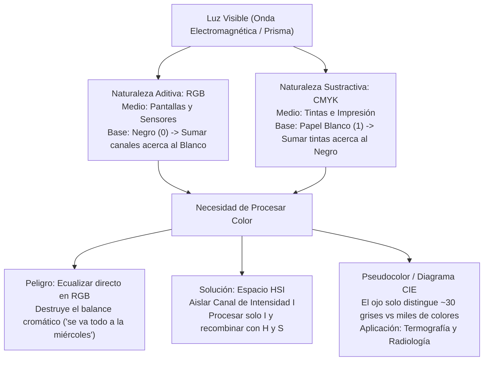

# Clase 17 — Unidad 6: Modelos de Color - RGB, CMYK, HSI y Pseudocolor

> [!info] Fecha y Contexto
> 📅 Martes, 3 de noviembre de 2026 — Semana 12  
> 📖 Unidad 6: Procesamiento de Imágenes en Color.  
> 🔗 Conceptos clave: [[Modelos de Color RGB y CMYK]], [[Espacio de Color HSI y Procesamiento Cromático]], [[Diagrama de Cromaticidad CIE y Pseudocolor]]  
> 💻 Práctica de código: [[Modelos de Color y Pseudocolor - Python]]

---

## 🎯 Idea Principal: Naturaleza Física y Perceptual del Color

El color es una experiencia psicofísica provocada por la interacción de la radiación electromagnética (luz en el rango de $\approx 380\text{ nm}$ a $750\text{ nm}$) con los fotorreceptores de la retina humana (conos tipo L, M y S sensibles a longitudes de onda largas, medias y cortas).

En visión por computador existen dos formas radicalmente distintas de concebir el color:
1. **Desde los dispositivos físicos**:
   - **RGB**: Emisión de luz (*Naturaleza Aditiva* — pantallas, monitores, sensores).
   - **CMYK**: Absorción y reflexión de pigmentos (*Naturaleza Sustractiva* — impresoras, papel).
2. **Desde la percepción humana y el procesamiento digital**:
   - **HSI (Hue, Saturation, Intensity)**: Desacopla la información cromática pura (matiz y saturación) del nivel de iluminación (intensidad).
   - **Pseudocolor**: Asignación artificial de colores a imágenes en escala de grises para potenciar la limitada capacidad del ojo humano al detectar anomalías.

---

## 💡 1. Naturaleza Aditiva (RGB) vs Sustractiva (CMYK)

### 1.1. Modelo RGB (Naturaleza Aditiva)
- **Principio físico**: Basado en la **emisión directa de luz**.
- **Medio**: Pantallas de monitores, televisores OLED/LCD, proyectores y matrices de sensores CCD/CMOS en cámaras.
- **Punto de partida**: La ausencia total de luz es la oscuridad o **negro puro** $(0, 0, 0)$.
- **Dinámica**: A medida que iluminamos y encendemos los subpíxeles de fósforos o LED (rojo, verde y azul), las intensidades se suman.
- **Resultado límite**: La combinación de los tres canales a máxima intensidad produce **blanco puro** $(255, 255, 255)$:
$$\text{Rojo} + \text{Verde} + \text{Azul} = \text{Blanco}$$

### 1.2. Modelo CMYK (Naturaleza Sustractiva)
- **Principio físico**: Basado en la **absorción y sustracción de longitudes de onda** reflejadas.
- **Medio**: Impresión gráfica, prensas litográficas, impresoras de inyección/láser y pigmentos textiles.
- **Punto de partida**: El sustrato base es el **papel blanco**, que posee la **luminosidad tope del espectro** (refleja toda la luz ambiental que incide sobre él).
- **Dinámica**: Las tintas translúcidas de Cian, Magenta y Amarillo actúan como filtros ópticos restando componentes espectrales a la luz reflejada.
- **Resultado límite**: Sumar tintas reduce la luz reflejada y nos acerca al **negro**:
$$\text{Cian (resta rojo)} + \text{Magenta (resta verde)} + \text{Amarillo (resta azul)} \approx \text{Negro}$$

> [!important] ¿Por qué se agrega la tinta "K" (Key / Negro Puro)?
> Teóricamente, mezclar $100\%$ de C, M e Y debería generar negro absoluto. En la realidad física, debido a impurezas químicas y a la dispersión de los pigmentos comerciales, mezclar C, M e Y produce un tono pardo/marrón sucio y humedece excesivamente el papel. Por ello se añade un cartucho de tinta negra pura (**Key** o $K$), lo que reduce drásticamente el costo de impresión y otorga negros profundos con bordes afilados en texto.

---

## 🎨 2. ¿Por qué el Color? El Dilema Computacional Industrial

> [!quote] Reflexión de Clase
> *"¿Por qué procesar color si en la industria casi todo está en escala de grises o binario? Porque la captura rápida busca velocidad y simplicidad matemática: procesar 3 canales triplica el costo de memoria y procesamiento. Pero en tareas de inspección de calidad, identificación de componentes biológicos o segmentación semántica, el color es el único descriptor capaz de discriminar objetos con idéntica textura e intensidad."*

---

## 👁️ 3. Modelo HSI: El Lenguaje Visual Humano

El modelo **HSI** (*Hue, Saturation, Intensity* — Matiz, Saturación, Intensidad) describe el color tal como lo interpreta el cerebro humano:

1. **H (Hue / Matiz / Tonalidad)**:
   - Representa la longitud de onda dominante del color espectral puro (rojo, amarillo, verde, cian, azul, magenta).
   - Se modela como un **ángulo angular** entre $0^\circ$ y $360^\circ$ sobre el círculo cromático ($0^\circ = \text{Rojo}$, $120^\circ = \text{Verde}$, $240^\circ = \text{Azul}$).
2. **S (Saturation / Saturación / Pureza)**:
   - Indica qué tan puro o diluido con luz blanca está el color ($[0, 1]$ o $[0, 255]$).
   - Un valor de $1.0$ es un color vibrante puro; un valor cercano a $0.0$ es un tono deslavado, pastel o escala de gris neutra.
3. **I (Intensity / Intensidad o Luminancia)**:
   - Magnitud acromática que cuantifica qué tan brillante u oscuro es el píxel, independiente de su tono:
$$I = \frac{R + G + B}{3}$$

---

## ⚡ 4. La Regla de Oro del Procesamiento en Color: Evitar el Error en RGB

> [!caution] El Error Clásico en RGB ("Se va todo a la miércoles")
> Si tomas una imagen en color y aplicas ecualización de histograma o ajuste de contraste **directamente canal por canal en $R$, $G$ y $B$**, las relaciones proporcionales entre las tres componentes se rompen de forma desigual.
> - **Consecuencia**: Los matices cambian erráticamente. Un rostro humano adquiere tonos verdes cadavéricos o púrpuras, arruinando la fidelidad cromática.

### El Protocolo Correcto de Procesamiento con HSI:
Para realzar contraste, nitidez o aplicar filtros espaciales (como suavizado o enfoque) sin alterar los colores:
1. **Conversión de Espacio**: Transformar la imagen de $RGB \to HSI$.
2. **Desacoplamiento**: Aislar exclusivamente la matriz de **Intensidad ($I$)**.
3. **Procesamiento**: Aplicar el algoritmo (ecualización, corrección gamma, filtro Laplaciano o máscara de desenfoque) **únicamente sobre el canal $I$**, manteniendo intactos los canales de Matiz ($H$) y Saturación ($S$).
4. **Recombinación**: Ensamblar la tupla $(H, S, I_{\text{procesado}})$.
5. **Conversión Inversa**: Transformar de vuelta de $HSI \to RGB$.

**Resultado**: La imagen gana contraste dinámico perfecto y nitidez cristalina sin el menor corrimiento de tono en los objetos.

---

## 🌈 5. Diagrama de Cromaticidad CIE y Técnicas de Pseudocolor

### 5.1. El Diagrama CIE 1931 y la Luz como Onda
Al hacer incidir un haz de luz blanca sobre un prisma de vidrio, la refracción la descompone en un continuo de frecuencias electromagnéticas. 

En 1931, la Comisión Internacional de Iluminación (*CIE*) definió el **Diagrama de Cromaticidad $(x, y)$**, el cual mapea todos los colores visibles:
- El contorno exterior curvado (*locus espectral*) contiene las longitudes de onda monocromáticas puras ($380\text{ nm}$ a $700\text{ nm}$).
- La línea recta inferior conecta el rojo con el violeta (línea de púrpuras no espectrales).
- El centro representa el blanco de referencia acromático (punto $(x, y) = (1/3, 1/3)$).

### 5.2. Pseudocolor (Falso Color): Superando la Limitación Humana
El ojo humano es extremadamente deficiente para discriminar niveles de gris adyacentes:
- En condiciones normales, el ojo solo es capaz de distinguir **entre 20 y 30 niveles de gris simultáneos**.
- Sin embargo, el sistema visual humano puede diferenciar **cientos de miles de variaciones cromáticas de tono y saturación**.

#### Aplicaciones Reales de Pseudocolor:
1. **Termografía Industrial y Eléctrica**:
   - En una cámara infrarroja, las diferencias de radiación térmica en un tablero eléctrico son sutiles matices de gris difíciles de diagnosticar.
   - Al aplicar un mapa de pseudocolor (*Colormap Jet / Inferno*), los puntos calientes críticos por sobrecarga saltan de inmediato a la vista en color **rojo incandescente o amarillo**, mientras que las zonas frías se proyectan en **azul oscuro**.
2. **Radiología y Tomografía Médica**:
   - Diferenciación de densidades óseas frente a tejidos blandos o microcalcificaciones oncológicas mediante escalas pseudocolor de alto contraste perceptivo.
3. **Imágenes Satelitales (Teledetección)**:
   - Mapeo de índices de vegetación (NDVI) y humedad del suelo.

---

## 🔗 Resumen de Modelos y Enlaces

| Modelo | Tipo | Canales | Medio Principal | Operación Clave |
| :--- | :--- | :--- | :--- | :--- |
| **RGB** | Aditivo (Luz) | Red, Green, Blue | Pantallas, Sensores | Sumar intensidades acerca al Blanco |
| **CMYK** | Sustractivo (Pigmentos) | Cyan, Magenta, Yellow, Key | Impresión, Papel | Sumar tintas acerca al Negro |
| **HSI** | Perceptual (Humano) | Hue, Saturation, Intensity | Procesamiento y Realce | Desacopla luminancia $I$ de crominancia $(H,S)$ |
| **Pseudocolor** | Mapeo LUT | Nivel de Gris $\to (R, G, B)$ | Termografía, Radiología | Expande $\approx 30$ grises a miles de colores |

### Notas relacionadas
- [[Modelos de Color RGB y CMYK]] — Fundamentos de síntesis aditiva y sustractiva.
- [[Espacio de Color HSI y Procesamiento Cromático]] — Geometría HSI y procesamiento sobre el canal de intensidad.
- [[Diagrama de Cromaticidad CIE y Pseudocolor]] — Espacio CIE 1931 y mapas térmicos por falso color.
- [[Modelos de Color y Pseudocolor - Python]] — Laboratorio práctico con OpenCV.
- [[Operaciones Morfológicas Binarias]] — Procesamiento morfológico previo.
- [[Inicio]] — Hub principal de la asignatura.
