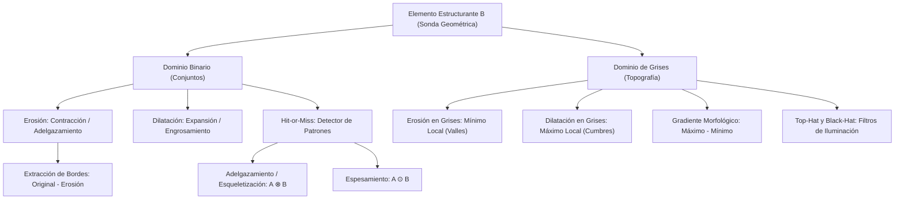

# Clase 16 — Unidad 5: Morfología Matemática - Binaria y Escala de Grises

> [!info] Fecha y Contexto
> 📅 Martes, 3 de noviembre de 2026 — Semana 12  
> 📖 Unidad 5: Procesamiento Morfológico de Imágenes.  
> 🔗 Conceptos clave: [[Operaciones Morfológicas Binarias]], [[Transformación Hit-or-Miss]], [[Adelgazamiento, Espesamiento y Esqueletización]], [[Morfología en Escala de Grises]]  
> 💻 Práctica de código: [[Morfología Matemática y Hit-or-Miss - Python]]

---

## 🎯 Idea Principal: Geometría, Conjuntos y Topografía

A diferencia del filtrado lineal espacial por convolución (que promedia intensidades), la **Morfología Matemática** analiza la forma geométrica de los objetos mediante la interacción con una sonda conocida: el **Elemento Estructurante** ($B$).

En esta sesión se abordan los dos mundos fundamentales del álgebra morfológica:
1. **Dominio Binario**: Basado en **Teoría de Conjuntos** ($\mathbb{Z}^2$). Las operaciones clave son la unión ($\cup$) y la intersección ($\cap$).
2. **Dominio de Escala de Grises**: Basado en **Superficies Topográficas** ($\mathbb{Z}^2 \times \mathbb{R}$). Las operaciones clave son el **Máximo Local** ($\max$) y el **Mínimo Local** ($\min$).

---

## 🔬 1. Elemento Estructurante (Structuring Element - SE)

El elemento estructurante $B$ es una sub-matriz pequeña (típicamente $3\times 3$, $5\times 5$, o formas como discos, rectángulos y cruces) con un **punto de ancla u origen** $(x_0, y_0)$. A medida que se desplaza sobre la imagen, actúa como una sonda que comprueba inclusiones, intersecciones, máximos y mínimos.

---

## ✂️ 2. Erosión y Dilatación Binarias

### 2.1. Erosión ($A \ominus B$)
Conjunto de todos los puntos $z$ donde $B$ queda **completamente contenido** dentro de $A$:
$$A \ominus B = \{ z \in \mathbb{Z}^2 \mid (B)_z \subseteq A \}$$
- **Efecto**: Encoge figuras blancas, rompe istmos estrechos y suprime islas de ruido menores que $B$.

### 2.2. Dilatación ($A \oplus B$)
Conjunto de desplazamientos $z$ donde el elemento reflejado $\hat{B}$ **se intersecta al menos en un punto** con $A$:
$$A \oplus B = \{ z \in \mathbb{Z}^2 \mid (\hat{B})_z \cap A \neq \emptyset \}$$
- **Efecto**: Expande figuras blancas, sella fracturas internas y fusiona objetos contiguos.

---

## 🔄 3. Principio de Dualidad Morfológica

> [!important] Declaración del Profesor
> *"Dilatar el objeto es matemáticamente idéntico a erosionar el fondo. Existe una estricta dualidad: si operamos sobre el objeto o el fondo da exactamente lo mismo, siempre que intercambiemos la operación y complementemos la imagen."*

$$(A \ominus B)^c = A^c \oplus \hat{B} \qquad (A \oplus B)^c = A^c \ominus \hat{B}$$

Erosionar el objeto blanco equivale a dilatar el fondo negro complementario ($A^c$) con el kernel reflejado $\hat{B}$ y volver a invertir el resultado.

---

## 🧼 4. Apertura y Cierre Morfológico

Para filtrar imperfecciones sin alterar el volumen macroscópico del objeto, combinamos ambas operaciones:

### 4.1. Apertura Morfológica ($A \circ B$)
Erosión seguida de dilatación con el mismo elemento $B$:
$$A \circ B = (A \ominus B) \oplus B$$
- Suaviza contornos desde **afuera**.
- Elimina islas de ruido exterior y protuberancias puntiagudas.
- **Idempotente**: $(A \circ B) \circ B = A \circ B$.
- **Anti-extensiva**: $A \circ B \subseteq A$.

### 4.2. Cierre Morfológico ($A \bullet B$)
Dilatación seguida de erosión con el mismo elemento $B$:
$$A \bullet B = (A \oplus B) \ominus B$$
- Suaviza contornos desde **adentro**.
- Rellena huecos internos, hoyos y suelda fracturas sin alterar el perímetro exterior.
- **Idempotente**: $(A \bullet B) \bullet B = A \bullet B$.
- **Extensiva**: $A \subseteq A \bullet B$.
- **Dualidad**: $(A \bullet B)^c = A^c \circ \hat{B}$.

---

## 📐 5. Extracción Morfológica de Bordes

> [!tip] Regla Simple de Clase
> $$\text{Original} - \text{Erosión} = \text{Borde}$$

Restando a la imagen original su versión erosionada, conservamos únicamente la franja superficial externa que fue eliminada por la erosión:

### Tipos de Bordes Morfológicos:
1. **Borde Interno ($\beta_{\text{int}}$)**:
   $$\beta(A) = A \setminus (A \ominus B) = A - (A \ominus B)$$
   Conserva una franja de grosor proporcional al tamaño de $B$ ubicada enteramente dentro del objeto original.
2. **Borde Externo ($\beta_{\text{ext}}$)**:
   $$\beta_{\text{ext}}(A) = (A \oplus B) \setminus A = (A \oplus B) - A$$
   Conserva la franja de expansión del objeto sobre el fondo circundante.
3. **Gradiente Morfológico Simétrico**:
   $$G(A) = (A \oplus B) - (A \ominus B)$$
   Combina la expansión y la contracción, generando bordes centrados y robustos.

**Aplicaciones directas**: Segmentación rápida de formas, análisis de perímetros industriales e inspección dimensional sin necesidad de calcular derivadas complejas.

---

## 🎯 6. Transformación Hit-or-Miss ($A \circledast B$)

Detector morfológico exacto de patrones geométricos (*Todo o Nada*). Utiliza un elemento estructurante compuesto $B = (B_1, B_2)$ con $B_1 \cap B_2 = \emptyset$:
$$A \circledast B = (A \ominus B_1) \cap (A^c \ominus B_2)$$
- $B_1$ evalúa el acierto con el objeto (**Hit** / valor `+1`).
- $B_2$ evalúa el acierto con el fondo (**Miss** / valor `-1`).
- Píxeles exteriores marcados con `0` representan condiciones indiferentes (*Don't Care*).

---

## 🪚 7. Adelgazamiento, Espesamiento y Esqueletización

### 7.1. Adelgazamiento (*Thinning*, $A \otimes B$)
Consiste en restar a la imagen original aquellos píxeles que coinciden exactamente con un patrón de borde detectado por Hit-or-Miss:
$$A \otimes B = A \setminus (A \circledast B)$$

Aplicando un banco secuencial de kernels rotados en bucle iterativo hasta que no ocurran más cambios, se alcanza la **Esqueletización Topológica**:
- Se reduce el objeto a su **máxima expresión** (líneas de 1 píxel de espesor).
- Se preserva rigurosamente la **conectividad y la topología original** (no se generan agujeros artificiales ni se desconectan ramas).

### 7.2. Espesamiento (*Thickening*, $A \odot B$)
Es la operación dual del adelgazamiento:
$$A \odot B = A \cup (A \circledast B)$$
En lugar de restar, va agregando píxeles seleccionados por la sonda morfológica para engordar y sellar estructuras de forma controlada. Se cumple la dualidad estricta con el fondo:
$$(A \odot B)^c = A^c \otimes B$$

### 7.3. Casos de Estudio Reales (Mencionados en Clase)

#### A. Sensores Biométricos de Huellas Dactilares (Efecto de Sobrepresión):
- **Problema**: Cuando un usuario apoya el dedo en el lector biométrico y presiona con demasiada fuerza, las crestas papilares se aplastan contra el cristal, fusionándose y generando una **"sombra fea" o empastamiento** negro de gran grosor.
- **Solución Morfológica**: El algoritmo aplica **adelgazamiento morfológico iterativo** ($A \otimes B$). Sin importar cuánta sombra o ensanchamiento provocó la presión física, la cresta papilar se colapsa a su línea central de 1 píxel. A partir de esa línea limpia, se detectan de forma infalible las **minucias** (bifurcaciones y terminaciones).

#### B. Cámaras de Foto-Multa y Reconocimiento de Placas (ALPR):
- **Problema**: En cámaras de control de tráfico a alta velocidad, las placas vehiculares sufren de desgaste: caracteres despintados, sombras de iluminación o variación de escala (el vehículo pasa cerca o lejos de la cámara).
- **Solución Morfológica**: A los modelos de reconocimiento óptico de caracteres (OCR) no les interesa el grosor superficial de la pintura, sino la **forma base** de la letra. Al aplicar esqueletización a la letra "A", aunque esté gruesa, despintada o lejana, su grafo topológico (dos ramas laterales, un vértice superior y una barra horizontal) es único e invariable, permitiendo clasificarla con total precisión.

---

## ⛰️ 8. Morfología en Escala de Grises: La Interpretación Topográfica

Al pasar de imágenes binarias a imágenes en niveles de gris ($f: \mathbb{Z}^2 \to [0, 255]$), la imagen deja de ser un simple conjunto plano y pasa a modelarse como una **superficie topográfica 3D**:
- Las coordenadas $(x, y)$ representan el plano geográfico base.
- El nivel de gris $f(x, y)$ representa la **altitud o elevación $z$**.
- Las zonas brillantes son **picos, mesetas o cumbres**.
- Las zonas oscuras son **cuencas, hoyos o valles**.

### Comparativo Fundamental: Dominio Binario vs Dominio de Grises

| Criterio | Dominio Binario ($\mathbb{Z}^2$) | Dominio de Niveles de Gris ($\mathbb{Z}^2 \times \mathbb{R}$) |
| :--- | :--- | :--- |
| **Modelo Matemático** | Teoría de Conjuntos | Superficie Topográfica 3D |
| **Dilatación ($A \oplus B$)** | **Unión** de traslaciones ($\bigcup$) | **Máximo Local** ($\max$) en la vecindad de $B$ |
| **Erosión ($A \ominus B$)** | **Intersección** de traslaciones ($\bigcap$) | **Mínimo Local** ($\min$) en la vecindad de $B$ |
| **Efecto de Dilatación** | Engrosa objetos blancos | Eleva los valles y expande las cumbres brillantes |
| **Efecto de Erosión** | Adelgaza objetos blancos | Hunde las cumbres y expande los valles oscuros |
| **Apertura ($f \circ b$)** | Remueve islas exteriores | Suprime picos brillantes pequeños (ruido blanco) |
| **Cierre ($f \bullet b$)** | Sella agujeros interiores | Rellena cuencas oscuras pequeñas (ruido negro) |

### 8.1. Formulación con Elemento Estructurante Plano
Para un elemento estructurante plano de soporte $B$ (donde los valores del kernel son cero):

- **Dilatación en Grises**:
  $$(f \oplus b)(x, y) = \max_{(s, t) \in B} \{ f(x - s, y - t) \}$$
- **Erosión en Grises**:
  $$(f \ominus b)(x, y) = \min_{(s, t) \in B} \{ f(x + s, y + t) \}$$

### 8.2. Gradiente Morfológico en Grises
$$G(f) = (f \oplus b) - (f \ominus b) = \text{Máximo Local} - \text{Mínimo Local}$$
En regiones planas o suaves, el máximo y el mínimo son casi idénticos, por lo que $G(f) \approx 0$. En bordes o pendientes abruptas, la diferencia se dispara, generando mapas de bordes continuos sin requerir kernels de Sobel direccionales.

---

## 🔗 Resumen de Fórmulas y Enlaces

| Operación | Definición | Interpretación Práctica |
| :--- | :--- | :--- |
| **Borde Interno** | $\beta(A) = A - (A \ominus B)$ | Original menos Erosión = Borde |
| **Adelgazamiento** | $A \otimes B = A \setminus (A \circledast B)$ | Reduce grosor conservando conectividad topológica |
| **Espesamiento** | $A \odot B = A \cup (A \circledast B)$ | Operación dual de relleno morfológico |
| **Dilatación Grises** | $(f \oplus b)(x, y) = \max_{B} f$ | Operador de Máximo Local topográfico |
| **Erosión Grises** | $(f \ominus b)(x, y) = \min_{B} f$ | Operador de Mínimo Local topográfico |
| **Gradiente Morfológico** | $G(f) = (f \oplus b) - (f \ominus b)$ | Detección no lineal de bordes |

### Notas relacionadas
- [[Operaciones Morfológicas Binarias]] — Fundamentos de conjuntos, dualidad y bordes.
- [[Transformación Hit-or-Miss]] — Detección de patrones y minucias.
- [[Adelgazamiento, Espesamiento y Esqueletización]] — Teoría de preservación topológica, huellas y foto-multas.
- [[Morfología en Escala de Grises]] — Superficies 3D, máximos/mínimos locales y gradientes.
- [[Morfología Matemática y Hit-or-Miss - Python]] — Scripts ejecutables y comparativas visuales.
- [[Inicio]] — Hub principal de la asignatura.
