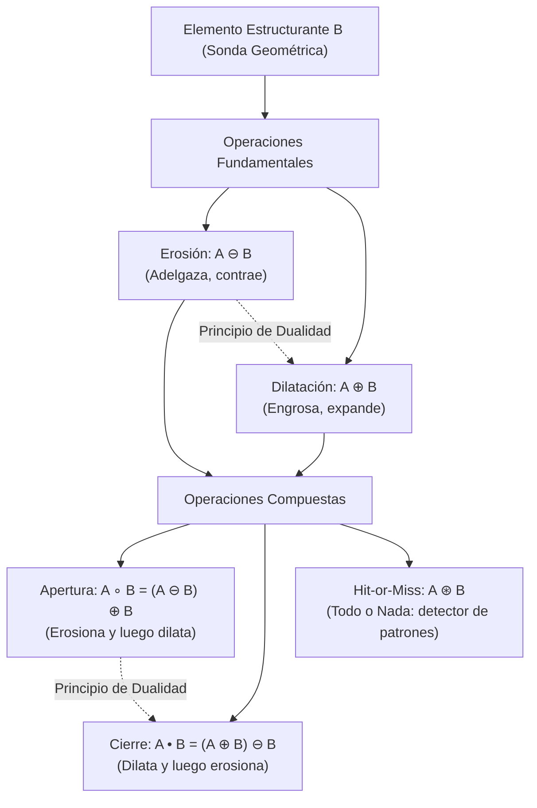
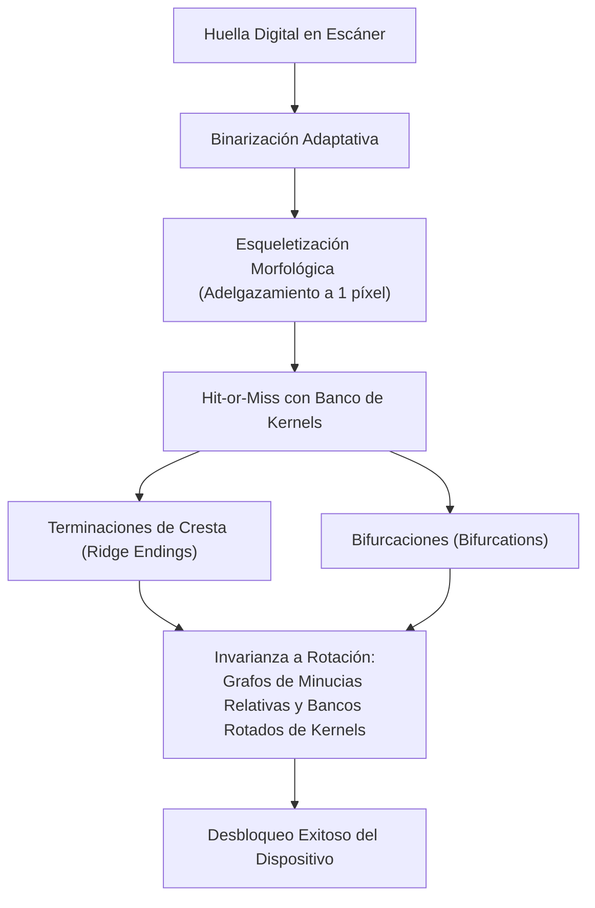

# Clase 16 — Unidad 5: Morfología Matemática en Imágenes Binarias

> [!info] Fecha y Contexto
> 📅 Martes, 3 de noviembre de 2026 — Semana 12  
> 📖 Unidad 5: Procesamiento Morfológico de Imágenes.  
> 🔗 Conceptos clave: [[Operaciones Morfológicas Binarias]], [[Transformación Hit-or-Miss]]  
> 💻 Práctica de código: [[Morfología Matemática y Hit-or-Miss - Python]]

---

## 🎯 Idea Principal: Geometría y Conjuntos en Imágenes

A diferencia del filtrado espacial lineal (donde calculamos sumas ponderadas de intensidades mediante convolución), la **Morfología Matemática** trata a las imágenes binarias como **conjuntos discretos** en el espacio bidimensional $\mathbb{Z}^2$. 

Un objeto es el conjunto de coordenadas de los píxeles blancos (valor 1 ó 255), y el fondo es el conjunto complementario de píxeles negros (valor 0):

$$A = \{ (x, y) \mid f(x, y) = 1 \}$$

Las operaciones morfológicas interrogan la imagen haciendo interactuar dicho conjunto $A$ con una pequeña sonda geométrica conocida predeterminada: el **Elemento Estructurante** ($B$ o *Structuring Element*, SE).

---

## 🔬 1. Elemento Estructurante (Structuring Element - SE)

El elemento estructurante $B$ es una sub-imagen binaria pequeña (típicamente $3\times 3$, $5\times 5$, o matrices con formas geométricas como discos, cruces o líneas) que posee un **origen o centro de anclaje** $(x_0, y_0)$.

A medida que el origen de $B$ se desplaza sobre cada coordenada de la imagen, se evalúa cómo coincide la forma de $B$ con el vecindario local del objeto.

---

## ✂️ 2. Erosión y Dilatación

### 2.1. Erosión ($A \ominus B$)
La erosión del conjunto $A$ por el elemento estructurante $B$ se define formalmente como el lugar geométrico de todos los puntos $z$ donde la traslación de $B$ queda **completamente contenida** dentro de $A$:

$$A \ominus B = \{ z \in \mathbb{Z}^2 \mid (B)_z \subseteq A \}$$

* **Efecto visual**: Encoge o adelgaza las figuras blancas.
* **Comportamiento geométrico**:
  1. Elimina islas o componentes conexos más pequeños que el elemento estructurante.
  2. Desconecta o rompe istmos y puentes delgados entre dos masas conexas.
  3. Reduce el perímetro y el área total del objeto.

### 2.2. Dilatación ($A \oplus B$)
La dilatación del conjunto $A$ por el elemento estructurante $B$ es el conjunto de todos los desplazamientos $z$ donde la reflexión de $B$ ($\hat{B}$) **se solapa o intersecta al menos en un píxel** con $A$:

$$A \oplus B = \{ z \in \mathbb{Z}^2 \mid (\hat{B})_z \cap A \neq \emptyset \}$$

donde $\hat{B} = \{ -b \mid b \in B \}$ es la reflexión de $B$ respecto a su origen.

* **Efecto visual**: Expande o engrosa las figuras blancas.
* **Comportamiento geométrico**:
  1. Rellena pequeños hoyos, porosidades y grietas internas.
  2. Conecta componentes desconectados que se encuentren separados por distancias menores al tamaño de $B$.
  3. Aumenta el área total del objeto.

---

## 🔄 3. Principio de Dualidad Morfológica

> [!important] Declaración del Profesor
> *"Dilatar el objeto es matemáticamente idéntico a erosionar el fondo. Existe una estricta dualidad: si operamos sobre el objeto o el fondo da exactamente lo mismo, siempre que intercambiemos la operación y complementemos la imagen."*

Matemáticamente, la erosión y la dilatación son **operadores duales** respecto a la complementación del conjunto:

$$(A \ominus B)^c = A^c \oplus \hat{B}$$

$$(A \oplus B)^c = A^c \ominus \hat{B}$$

### ¿Por qué ocurre esto?
- En una imagen binaria, el fondo negro $A^c$ es el inverso booleano del objeto blanco $A$.
- Si erosionamos el objeto blanco, el objeto se contrae, lo que significa que el fondo negro está ganando territorio (se está **dilatando**).
- Por tanto: **Erosionar $A$ equivale a dilatar el fondo $A^c$ con el elemento reflejado $\hat{B}$ y luego volver a invertir el resultado.**

---

## 🧼 4. Apertura y Cierre Morfológico

Tanto la erosión pura como la dilatación pura alteran severamente el tamaño global del objeto (lo encogen o lo engordan). Para filtrar ruido sin alterar las dimensiones macroscópicas globales del objeto, combinamos ambas operaciones en cascada.

### 4.1. Apertura Morfológica ($A \circ B$)
Consiste en una **erosión seguida de una dilatación** utilizando el mismo elemento estructurante $B$:

$$A \circ B = (A \ominus B) \oplus B$$

* **Propósito**:
  - Elimina el ruido externo (pequeñas islas o motas blancas en el fondo).
  - Suaviza los contornos del objeto **desde afuera** (elimina pequeñas protuberancias y salientes puntiagudas).
  - Rompe istmos y filamentos estrechos.
* **Propiedades fundamentales**:
  - **Anti-extensiva**: $A \circ B \subseteq A$ (el resultado nunca excede el objeto original).
  - **Idempotente**: $(A \circ B) \circ B = A \circ B$ (aplicar apertura varias veces consecutivas no altera más la imagen después de la primera vez).

### 4.2. Cierre Morfológico ($A \bullet B$)
Es la operación dual de la apertura: consiste en una **dilatación seguida de una erosión** utilizando el mismo elemento estructurante $B$:

$$A \bullet B = (A \oplus B) \ominus B$$

* **Propósito**:
  - Elimina el ruido interno (rellena agujeros negros y porosidades dentro del objeto).
  - Suelda fracturas, grietas y fisuras internas delgadas.
  - Suaviza los contornos del objeto **desde adentro** rellenando entrantes y hendiduras sin modificar el perímetro macroscópico exterior.
* **Propiedades fundamentales**:
  - **Extensiva**: $A \subseteq A \bullet B$ (el resultado siempre contiene al objeto original).
  - **Idempotente**: $(A \bullet B) \bullet B = A \bullet B$.
  - **Dualidad con la Apertura**: $(A \bullet B)^c = A^c \circ \hat{B}$.

---

## 🎯 5. Transformación Hit-or-Miss (Acierto o Desacierto / Todo o Nada)

La transformación **Hit-or-Miss** ($A \circledast B$) es la herramienta básica de la morfología matemática para la **detección exacta de formas, esquinas, terminaciones y patrones geométricos**.

### 5.1. Formulación Matemática
A diferencia de las operaciones estándar que usan un solo elemento, Hit-or-Miss utiliza un elemento estructurante compuesto $B = (B_1, B_2)$:
- $B_1$: subconjunto que debe coincidir con el **objeto blanco** (*Hit* / Acierto).
- $B_2$: subconjunto que debe coincidir con el **fondo negro** (*Miss* / Desacierto), donde $B_1 \cap B_2 = \emptyset$.

$$A \circledast B = (A \ominus B_1) \cap (A^c \ominus B_2)$$

### 5.2. Representación en Matriz Tri-Estado en OpenCV
En OpenCV y bibliotecas de visión por computador, el kernel de Hit-or-Miss se modela con valores tri-estado:
- `+1`: El píxel **debe** pertenecer al objeto (Hit).
- `-1`: El píxel **debe** pertenecer al fondo (Miss).
- `0`: Píxel "no importa" (*Don't Care* / indiferente).

Ejemplo de kernel para detectar la **esquina superior derecha** de un objeto rectangular:
$$\begin{bmatrix} 0 & -1 & -1 \\ 1 & 1 & -1 \\ 0 & 1 & 0 \end{bmatrix}$$

---

## 📱 6. Caso de Estudio: Reconocimiento Biométrico de Huellas Dactilares

> [!example] Pregunta de Clase
> *"Si yo desbloqueo el celular con huella digital, ¿por qué lo puedo colocar de cualquier forma y el sensor igual lo reconoce?"*

En los lectores biométricos y algoritmos AFIS (*Automated Fingerprint Identification System*), la morfología binaria y la transformación Hit-or-Miss juegan un papel crucial:

1. **Esqueletización (Thinning)**:
   Mediante aplicaciones iterativas de Hit-or-Miss, las crestas papilares de la huella se adelgazan hasta tener exactamente **1 píxel de grosor**.
2. **Detección de Minucias con Hit-or-Miss**:
   - Una **terminación de cresta** (*ridge ending*) es un píxel 1 rodeado por exactamente un solo vecino 1 y siete vecinos 0 en su vecindario $3\times 3$.
   - Una **bifurcación** (*bifurcation*) es un píxel 1 donde una cresta se bifurca en dos ramas (exactamente tres vecinos 1 no adyacentes).
   - Ambos patrones se detectan con kernels específicos de Hit-or-Miss.
3. **¿Cómo se logra la invarianza a la rotación al colocar el dedo?**
   - **Banco de filtros rotados**: Se diseñan kernels Hit-or-Miss girados en ángulos discretos ($0^\circ, 45^\circ, 90^\circ, \dots, 315^\circ$) o se extrae el campo de orientación local (*Ridge Orientation Map*).
   - **Emparejamiento por Minucias Relativas (Minutiae Matching)**: Una vez detectadas las coordenadas $(x_i, y_i)$ y orientaciones $\theta_i$ de las minucias, el sistema construye un **grafo de distancias relativas y ángulos internos**. Cuando apoyas el dedo torcido, el algoritmo aplica una transformación afín o RANSAC que alinea las constelaciones de puntos con la plantilla registrada.

---

## 🛠️ 7. Inspección de Piezas Industriales

En líneas de producción automatizadas:
- Se capturan siluetas de engranajes, arandelas o tornillos.
- La **apertura morfológica** descarta rebabas y virutas metálicas externas.
- El **cierre morfológico** sella porosidades superficiales menores que no comprometen la calidad estructural.
- La **diferencia morfológica** ($A \oplus B - A \ominus B$, llamada **Gradiente Morfológico**) extrae el contorno perfecto de la pieza con grosor controlado.
- Si comparamos la pieza inspeccionada contra una máscara de referencia mediante operaciones booleanas XOR y Hit-or-Miss, los defectos (como dientes rotos en un engranaje o faltantes) se aíslan de inmediato en tiempo real.

---

## 🔗 Resumen de Fórmulas y Enlaces

| Operación | Definición Matemática | Efecto Geométrico | Dualidad |
| :--- | :--- | :--- | :--- |
| **Erosión** | $A \ominus B = \{ z \mid (B)_z \subseteq A \}$ | Contrae el objeto, rompe puentes | $(A \ominus B)^c = A^c \oplus \hat{B}$ |
| **Dilatación** | $A \oplus B = \{ z \mid (\hat{B})_z \cap A \neq \emptyset \}$ | Engrosa el objeto, sella grietas | $(A \oplus B)^c = A^c \ominus \hat{B}$ |
| **Apertura** | $A \circ B = (A \ominus B) \oplus B$ | Elimina islas externas, suaviza contornos | $(A \circ B)^c = A^c \bullet \hat{B}$ |
| **Cierre** | $A \bullet B = (A \oplus B) \ominus B$ | Rellena hoyos internos, suelda fisuras | $(A \bullet B)^c = A^c \circ \hat{B}$ |
| **Hit-or-Miss** | $A \circledast B = (A \ominus B_1) \cap (A^c \ominus B_2)$ | Detección exacta de patrones y esquinas | Extensión de teoría de conjuntos |

### Notas relacionadas
- [[Operaciones Morfológicas Binarias]] — Concepto teórico exhaustivo y propiedades algebraicas.
- [[Transformación Hit-or-Miss]] — Algoritmos de acierto/desacierto, minucias y esqueletización.
- [[Morfología Matemática y Hit-or-Miss - Python]] — Laboratorio práctico con OpenCV y scripts ejecutables.
- [[Operaciones Lógicas y Álgebra Booleana en Imágenes]] — Fundamento booleano subyacente.
- [[Inicio]] — Índice general de la materia.
