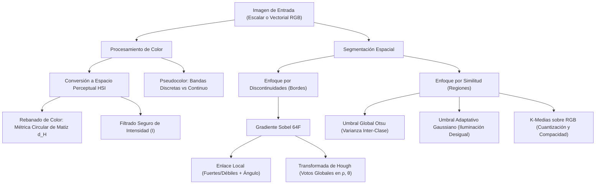
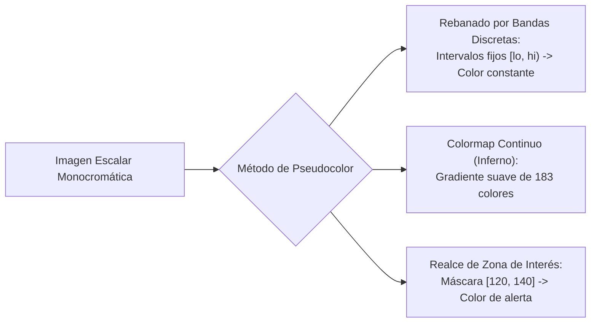

# Clase 18 — Unidad 6: Color y Segmentación de Imágenes

> [!info] Fecha y Contexto
> 📅 Miércoles, 4 de noviembre de 2026 — Semana 12  
> 📖 Unidad 6: Procesamiento de Imágenes en Color y Técnicas de Segmentación.  
> 🔗 Conceptos clave: [[Modelos de Color RGB y CMYK]], [[Espacio de Color HSI y Procesamiento Cromático]], [[Diagrama de Cromaticidad CIE y Pseudocolor]], [[Rebanado de Color y Operaciones Cromáticas]], [[Enlace Local de Bordes]], [[Transformada de Hough]], [[Segmentación por Umbralización - Otsu y Adaptativo]], [[Segmentación y Cuantización por K-Medias]]  
> 💻 Prácticas de código: [[Procesamiento y Rebanado de Color - Python]], [[Segmentación por Bordes y Agrupamiento - Python]], [[Modelos de Color y Pseudocolor - Python]]  
> 📚 Referencias base: Presentaciones 5.3 y 5.4; Notebooks 5.3, 5.4, 6.1 y 6.2.

---

## 🎯 Síntesis Conceptual de la Sesión

Esta sesión profundiza en la transición desde el tratamiento del color como información multidimensional hacia su integración con operadores de segmentación morfológica y espacial:
1. **El píxel de color como vector tri-dimensional en $\mathbb{R}^3$**, analizando el enfoque escalar (por canal) vs el enfoque vectorial.
2. **Formulación analítica rigurosa de los modelos RGB, CMY/CMYK y HSI**, resolviendo discontinuidades circulares de matiz y desacoplando luminancia de crominancia.
3. **Pseudocolor y realce de interés**: rebanado por bandas discretas vs mapas continuos (`inferno`), y cuantificación de errores de discretización sobre rejillas discretas.
4. **Procesamiento cromático a todo color**: complemento, rotación de matiz ($H'$), desaturación con intensidad $I$ intacta, rebanado de color (*color slicing*) con distancia angular circular y filtrado de intensidad.
5. **Detección de bordes y delimitación de fronteras**: limitaciones de la umbralización simple del gradiente de Sobel en rampas suaves, enlace local de bordes (*local edge linking*) con doble umbral y coherencia angular, y la Transformada de Hough para detección de alineaciones globales en contornos fragmentados.
6. **Segmentación por intensidad y agrupamiento**: umbralización óptima de Otsu frente a umbralización adaptativa local con iluminación irregular, y particionamiento no supervisado mediante K-medias sobre vectores RGB.



---

## 🎨 1. El Color como Información en Visión Artificial

El color proporciona descriptores indispensables para reconocer y aislar elementos cuando las intensidades en escala de grises coinciden. Para manipular computacionalmente el color se distinguen dos aproximaciones operativas:

| Enfoque | Representación Matemática | Operación Típica |
| :--- | :--- | :--- |
| **Por canal o escalar** | Cada canal matricial se procesa como una imagen monocromática 2D independiente. | Filtrado espacial o ecualización aplicada exclusivamente al canal de intensidad. |
| **Vectorial** | Cada píxel se procesa como un vector tridimensional conjunto $\vec{p} \in \mathbb{R}^3$. | Agrupamiento por distancia euclidiana o Mahalanobis en espacio de color (K-medias). |

> [!important] Estructura Matricial del Píxel
> Un píxel RGB no son tres matrices dispersas ni tres vectores independientes: es **un vector único con tres componentes**. Para una imagen de alto $M$ y ancho $N$, la estructura de datos es un tensor tridimensional de dimensiones $M \times N \times 3$.

---

## 📐 2. Modelos de Color: RGB, CMY y HSI

### 2.1. RGB: Modelo Aditivo de Luz
- Base física: Emisión directa de luz sobre fondo negro $(0, 0, 0)$.
- En cuantización de 8 bits por componente, cada canal toma valores enteros en $[0, 255]$, permitiendo $256^3 = 16\,777\,216$ combinaciones cromáticas dentro del cubo unitario RGB.
- El rojo puro se ubica en $(255, 0, 0)$, el blanco en $(255, 255, 255)$ y la diagonal principal define la escala de grises acromática ($R = G = B$).

### 2.2. CMY y CMYK: Modelo Sustractivo de Tintas
- Base física: Absorción y reflexión de pigmentos sobre papel blanco.
- En formulación normalizada en $[0, 1]$, la relación ideal con RGB es:
  $$C = 1 - R, \qquad M = 1 - G, \qquad Y = 1 - B$$
- En el notebook 5.3 se normaliza la imagen antes de calcular el complemento de cada canal. Al desplegar los canales C, M e Y por separado en escala de grises, se observa el nivel de absorción individual; el modelo completo CMY produce una imagen cromática real.
- El modelo comercial **CMYK** añade la componente negra $K$ (*Key*) para obtener negros profundos sin sobrehumedecer el sustrato de papel ni gastar tintas costosas.

### 2.3. HSI: Matiz, Saturación e Intensidad
Desacopla la información cromática de la luminancia global de la escena:
- **Matiz ($H$)**: Ángulo circular $\theta \in [0^\circ, 360^\circ)$ o normalizado $[0, 1)$ que indica la tonalidad espectral pura.
- **Saturación ($S$)**: Distancia radial al eje acromático; pureza del color ($S=1$ saturado puro, $S=0$ neutro/gris).
- **Intensidad ($I$)**: Promedio aritmético acromático de los tres canales RGB:
  $$I = \frac{R + G + B}{3}$$

#### Distribución de los primarios puros (con RGB normalizado):
| Primario Puro | Matiz ($H$) | Saturación ($S$) | Intensidad ($I$) |
| :--- | :---: | :---: | :---: |
| **Rojo puro** $(1, 0, 0)$ | **$0^\circ$** ($0.0$) | $1.0$ | $1/3 \approx 0.333$ |
| **Verde puro** $(0, 1, 0)$ | **$120^\circ$** ($0.333$) | $1.0$ | $1/3 \approx 0.333$ |
| **Azul puro** $(0, 0, 1)$ | **$240^\circ$** ($0.667$) | $1.0$ | $1/3 \approx 0.333$ |

> [!important] Corrección de Ángulo
> El ángulo angular exacto del azul puro en el círculo cromático HSI es **$240^\circ$**, no $250^\circ$.

#### Ecuaciones de conversión RGB $\to$ HSI:
1. **Intensidad**:
   $$I = \frac{R + G + B}{3}$$
2. **Saturación**:
   $$S = 1 - \frac{3 \min(R, G, B)}{R + G + B} \quad \text{(con } S = 0 \text{ si } R+G+B = 0 \text{ para evitar división por cero)}$$
3. **Matiz**:
   $$\theta = \arccos\left( \frac{\frac{1}{2}\left[(R - G) + (R - B)\right]}{\sqrt{(R - G)^2 + (R - B)(G - B)}} \right)$$
   $$H = \begin{cases} \theta & \text{si } B \le G \\ 2\pi - \theta & \text{si } B > G \end{cases}$$
   Dividiendo entre $2\pi$ se normaliza a $[0, 1)$. Multiplicando por $360^\circ$ se obtiene en grados.

> [!note] Inestabilidad en Píxeles Acromáticos
> En tonos grises donde $R = G = B$, el numerador y denominador de $\theta$ colapsan hacia cero: el matiz no tiene significado cromático porque no existe un color dominante. Por ello, cualquier segmentación por matiz debe verificar simultáneamente que la saturación sea superior a un umbral mínimo.
> Asimismo, la intensidad $I$ de HSI es un promedio simple; no equivale a la luminancia perceptual ponderada del ojo humano (como en YUV/Lab donde el verde tiene mayor peso que el azul).

### 2.4. Cromaticidad CIE y Gamut de Color
A partir de los valores triestímulo CIE XYZ:
$$x = \frac{X}{X + Y + Z}, \qquad y = \frac{Y}{X + Y + Z}$$
El diagrama $(x, y)$ mapea la cromaticidad de forma desacoplada de la luminancia absoluta. El perímetro curvilíneo (*locus espectral*) agrupa longitudes de onda monocromáticas puras, cerrado por la línea recta de los púrpuras. El triángulo formado por los primarios de un monitor delimita su **gamut** (rango reproducible de colores), demostrando por qué ninguna pantalla comercial puede reproducir todos los colores perceptibles por el ojo humano.

---

## 🌈 3. Pseudocolor: Asignación de Color a Datos Escalares

El pseudocolor asigna paletas cromáticas artificiales a datos escalares (imágenes térmicas, radiológicas o densitométricas) para potenciar la baja sensibilidad del ojo humano a los niveles de gris ($\approx 30$ niveles simultáneos frente a miles de colores).



### 3.1. Rebanado de Intensidad por Bandas
El notebook 5.3 divide el rango dinámico en 5 intervalos cerrados por la izquierda:
- $[0, 60)$: Azul oscuro
- $[60, 120)$: Celeste
- $[120, 180)$: Verde
- $[180, 230)$: Amarillo
- $[230, 256)$: Rojo (el límite 256 incluye el valor máximo 255 de 8 bits).

> [!tip] Aclaración sobre la Franja Amarilla
> Los apuntes preliminares indicaban que el color amarillo no aparecía. Sin embargo, el notebook registra **5 colores distintos**: el gradiente sintético de fondo alcanza el valor 180 (límite inferior de la banda amarilla), generando una franja perceptible aunque muy estrecha. Para verificar la presencia de una banda siempre se deben contar los píxeles booleanos de la máscara y no confiar exclusivamente en la inspección visual.

### 3.2. Colormap Continuo
El mapeo continuo utiliza una rampa progresiva de colores:
```python
colormap_continuo = plt.cm.inferno(imagen_termica / 255.0)[:, :, :3]
```
En la salida del laboratorio, mientras que el rebanado produce **5 colores discretos**, `inferno` genera **183 colores distintos**. La etiqueta "continuo" describe la suavidad de las transiciones visuales, no una infinitud matemática en el archivo digital.

### 3.3. Realce de una Zona de Interés
Sobre una escena compuesta por un círculo (gris 130), un rectángulo (gris 200) y fondo (gris 50), se define la máscara:
```python
mascara_interes = (imagen_base >= 120) & (imagen_base <= 140)
```
- Radio geométrico del círculo: $r = 40\text{ px}$.
- Área analítica: $A = \pi (40)^2 \approx 5026.55\text{ px}$.
- Área discreta medida: $5025\text{ px}$.
- Error relativo: $\approx 0.031\%$ (mostrado como $0.0\%$ con un decimal).

---

## 🔮 4. Procesamiento a Todo Color

### 4.1. Complemento o Negativo
Invierte las intensidades manteniendo inalterada la posición geométrica:
$$(R', G', B') = (255 - R, \; 255 - G, \; 255 - B)$$

### 4.2. Rotación del Matiz (*Hue Shift*)
Opera directamente sobre el canal angular en espacio HSI:
$$H' = (H + \Delta H) \bmod 1.0$$
Al sumar $120^\circ$ ($\Delta H = 120/360$), el rojo puro transmuta en verde puro. En la prueba de laboratorio con un píxel rojo $(255, 0, 0)$, el resultado es **$(0, 254, 0)$**; la variación de una unidad respecto a 255 proviene del truncamiento en la conversión de coma flotante a entero de 8 bits.

### 4.3. Reducción de Saturación
Multiplica la saturación por un factor $\alpha \in [0, 1]$:
$$S' = \alpha S$$
Con $\alpha = 0$, la escena se transforma en escala de grises acromática ($R = G = B = I$). **Reducir $S$ no requiere modificar $I$**: la luminancia permanece intacta.

### 4.4. Rebanada de Color (*Color Slicing*)
Permite aislar un objeto por su tono cromático utilizando la **distancia circular**:
$$d_H = \min\bigl(|H - H_0|, \, 1 - |H - H_0|\bigr)$$
```python
diferencia = np.abs(H_obj - 0.0)
distancia_matiz = np.minimum(diferencia, 1.0 - diferencia)
mascara_color = (distancia_matiz < 15.0 / 360.0) & (S_obj > 0.3)
```
- La tolerancia es de $15^\circ$ respecto al rojo ($0^\circ$).
- Para un círculo rojo de radio $r = 50$:
  - Área geométrica: $\pi (50)^2 \approx 7853.98\text{ px}$.
  - Área recuperada: $7845\text{ px}$.
  - Error relativo: $\approx 0.1\%$ (debido al escalonamiento de la cuadrícula de píxeles).
  - Píxeles seleccionados del rectángulo azul o fondo gris: **ninguno**.

### 4.5. Filtrado Espacial en Intensidad vs RGB
Filtrar una imagen RGB promediando cada canal por separado genera colores espurios en las fronteras entre regiones cromáticas contrastantes (por ejemplo, franjas amarillentas artificiales entre rojo y verde).
- **Estrategia óptima**: Convertir a HSI, aplicar el filtro (suavizado o derivada) **únicamente sobre el canal $I$**, y reconstruir con los canales $H$ y $S$ originales.
- El filtro Gaussiano suaviza ruido; las derivadas espaciales (como el Laplaciano) realzan altas frecuencias. La conversión cíclica HSI $\leftrightarrow$ RGB introduce un error medio tolerable de solo **$0.267$ niveles por canal** en 8 bits.

---

## 📐 5. Bordes y Fronteras: Localizar Cambios para Segmentar

### 5.1. Borde vs Frontera
- **Borde**: Discontinuidad diferencial local en intensidad, textura o color (calculada con Sobel).
- **Frontera**: Contorno continuo cerrado que delimita un objeto físico completo. Un mapa de bordes no equivale automáticamente a un conjunto de objetos reconocidos: presenta interrupciones, ruidos y detalles internos de textura.

### 5.2. Gradiente y Sobel en Punto Flotante
Se calculan las derivadas parciales mediante convolución espacial con máscaras $3 \times 3$ en precisión `float64`:
$$M(x, y) = \sqrt{G_x^2 + G_y^2}, \qquad \alpha(x, y) = \operatorname{atan2}(G_y, G_x)$$
El ángulo señala la dirección de máxima tasa de cambio (ortogonal a la dirección física del borde).

### 5.3. Umbral del Gradiente y Pérdida de Bordes Débiles
Al aplicar un umbral global simple de magnitud ($T = 100$) sobre una figura con un borde izquierdo escalón y un borde derecho con rampa suave:
- Se detecta el **$50.2\%$** de la franja izquierda abrupta.
- Se detecta apenas el **$0.6\%$** de la franja derecha suave.
Un umbral global único es incapaz de equilibrar la supresión de ruido con la preservación de transiciones sutiles.

### 5.4. Enlace Local de Bordes (*Local Edge Linking*)
Aprovecha la 8-vecindad y la coherencia orientacional de gradiente para rescatar candidatos débiles enlazados a bordes fuertes:
- **Píxeles fuertes**: Magnitud $M \ge 400$.
- **Píxeles débiles**: Magnitud $60 \le M < 400$.
- **Criterio de propagación**: Vecindad de 8 y diferencia angular $|\Delta \alpha| \le 30^\circ$.

En el experimento de laboratorio:
- La detección en la franja debilitada salta del **$0.0\%$ al $97.5\%$**.
- Los píxeles de ruido aislados no se incorporan al carecer de conexión con un borde fuerte.
- El algoritmo converge de forma estable en **11 iteraciones**.

### 5.5. Transformada de Hough para Detección de Rectas
Detecta alineaciones globales mediante acumulación de votos en el espacio normal:
$$\rho = x \cos \theta + y \sin \theta$$
Donde $\theta \approx 0^\circ$ corresponde a rectas verticales y $\theta \approx 90^\circ$ a rectas horizontales.

En el experimento con un rectángulo cuyos bordes fueron perforados con huecos:
- `cv2.HoughLines` con umbral de 80 votos retorna **16 detecciones** antes de consolidar líneas próximas.
- Al agrupar picos vecinos, recupera con precisión milimétrica las 4 rectas delimitadoras: $x \approx 50, x \approx 150, y \approx 50, y \approx 150$.
- **Principio**: Hough infiere el modelo analítico que explica la nube de puntos; no interpola ni restaura los píxeles ausentes en la imagen binaria.

| Criterio Comparativo | [[Enlace Local de Bordes]] | [[Transformada de Hough]] |
| :--- | :--- | :--- |
| **Evidencia primordial** | Adyacencia en vecindad local y coherencia angular. | Concentración global de votos en acumulador paramétrico. |
| **Continuidad requerida** | Obligatoria: requiere cadena continua de candidatos. | Innecesaria: conecta segmentos dispersos a través de huecos amplios. |
| **Resultado** | Mapa de bordes binarios enlazados. | Parámetros matemáticos de rectas $(\rho, \theta)$. |
| **Límite operativo** | No puede atravesar roturas sin candidatos válidos. | Restringido a la geometría del modelo analítico formulado. |

---

## 🧩 6. Segmentación por Intensidad y Agrupamiento

### 6.1. Umbral Global Fijo vs Algoritmo de Otsu
Otsu determina automáticamente el umbral $T$ que **maximiza la varianza inter-clase** $\sigma_B^2(T)$ (o minimiza la varianza intra-clase $\sigma_W^2(T)$) sobre el histograma normalizado.

En una imagen sintética bimodal (fondo $\approx 60$, objeto $\approx 180$):
- Umbral manual $T = 70$ (cercano al fondo): Exactitud del **$93.4\%$**.
- Umbral manual $T = 120$ (valle central): Exactitud del **$100.0\%$**.
- Umbral óptimo de Otsu ($T = 98$): Exactitud del **$100.0\%$**.
Cuando las distribuciones están ampliamente separadas, múltiples umbrales intermedios consiguen clasificación perfecta.

### 6.2. Umbral Adaptativo ante Iluminación Desigual
Cuando la escena presenta gradientes severos de iluminación, un umbral global confunde fondos oscuros con objetos. El umbral adaptativo calcula un corte local para cada píxel:
$$T(x, y) = \mu_{\text{Gauss}}(x, y) - C$$

En un experimento con **12 manchas oscuras circulares** ($r = 8\text{ px}$, área teórica $\approx 201\text{ px}$) sobre una superficie con gradiente de luz:
- **Otsu Global**: Detecta únicamente **7 componentes**, creando una gigantesca falsa región conectada de **$43\,800\text{ px}$** que absorbe varias manchas.
- **Adaptativo Local ($51 \times 51$, $C = 10$)**: Segmenta limpiamente las **12 manchas individuales**.

> [!important] La Métrica de Validación: Área Conexa
> Contar únicamente el número de manchas es insuficiente. El análisis de áreas conectadas detecta de inmediato fallas graves: una masa de $43\,800\text{ px}$ cuando los objetos reales miden $\approx 201\text{ px}$ evidencia un colapso en la segmentación global.

### 6.3. K-Medias sobre Píxeles RGB
Agrupa los píxeles interpretados como vectores en $\mathbb{R}^3$ (`pixeles.reshape(-1, 3)`), alternando entre asignación al centroide más cercano y actualización de medias. Al reemplazar cada píxel por su centroide se obtiene una **imagen cuantizada**:

| Parámetro $K$ | Colores Finales | Compacidad Intragrupo ($J$) |
| :---: | :---: | :---: |
| **$K = 2$** | $2$ | $\approx 1\,509\,795\,450$ |
| **$K = 4$** | $4$ | $\approx 525\,036\,317$ |
| **$K = 8$** | $8$ | $\approx 207\,013\,497$ |

- La compacidad $J$ disminuye al aumentar $K$, preservando mayor fidelidad espectral.
- **Advertencia crítica**: Una menor compacidad no equivale a una mejor detección de objetos físicos. K-medias no incorpora información espacial $(x, y)$: asigna la misma clase a regiones separadas con el mismo color y divide objetos continuos que presenten sombras o reflejos.

---

## ⚖️ 7. Relación entre Color, Forma y Significado

| Necesidad en Visión Artificial | Información Clave | Algoritmo / Método Estudiado |
| :--- | :--- | :--- |
| **¿Qué píxeles tienen valores similares?** | Intensidad o color espectral. | Umbrales (Otsu/Adaptativo), máscara HSI y K-medias. |
| **¿Dónde se producen cambios abruptos?** | Magnitud del gradiente diferencial. | Operador de Sobel en coma flotante. |
| **¿Qué fragmentos pertenecen al mismo borde?** | Continuidad espacial y ángulo local. | Enlace local de bordes (*Local Edge Linking*). |
| **¿Qué puntos obedecen a un alineamiento global?** | Modelo geométrico analítico. | Transformada de Hough en espacio $(\rho, \theta)$. |
| **¿Cómo interpretar visualmente datos escalares?** | Asignación cromática perceptual. | Pseudocolor por bandas discretas o mapas continuos (`inferno`). |

> [!tip] Semántica y Contexto
> Integrar color y morfología delimita regiones y genera descriptores robustos. Sin embargo, para asignar **significado semántico** (por ejemplo, reconocer una señal de tráfico de pare) se requieren reglas topológicas, descriptores de forma o clasificadores entrenados: una máscara cromática por sí sola jamás identifica un objeto de forma autónoma.

---

## 📌 8. Ideas Clave para Repasar

- RGB trata cada píxel como un vector tridimensional en $[0, 255]^3$; HSI desacopla matiz ($H$), saturación ($S$) e intensidad ($I$).
- El matiz es circular: Rojo $0^\circ$, Verde $120^\circ$ y Azul $240^\circ$. En tonos neutros acromáticos ($S \approx 0$), $H$ carece de estabilidad matemática.
- Desaturar consiste en reducir $S$ preservando intacto el canal $I$.
- El pseudocolor inventa paletas para datos escalares; el rebanado de color (*color slicing*) filtra colores preexistentes usando la distancia circular $d_H = \min(|H-H_0|, 1-|H-H_0|)$.
- El filtro Gaussiano suaviza variaciones; las derivadas espaciales realzan altas frecuencias y bordes.
- Un borde local no constituye una frontera cerrada ni un objeto reconocido.
- El enlace local requiere adyacencia continua de candidatos; la Transformada de Hough salta vacíos reuniendo votos en el espacio $(\rho, \theta)$.
- Otsu calcula un umbral global maximizando la varianza inter-clase; el umbral adaptativo compensa gradientes de iluminación locales.
- K-medias optimiza la compacidad espectral en $\mathbb{R}^3$, pero carece de conciencia sobre la conectividad espacial de la imagen.

---

## 📚 9. Material de Referencia y Notebooks

| Recurso Documental | Secciones y Contenido Específico |
| :--- | :--- |
| **`5.3 Modelos_de_Color_y_Pseudocolor.pdf`** | Págs. 2–6: modelos físicos, formulación HSI y cromaticidad CIE. Págs. 7–10: pseudocolor. |
| **`5_3_Modelos_de_Color_y_Pseudocolor.ipynb`** | §3.1: RGB, CMY y HSI. §3.2: bandas de pseudocolor y mapa inferno. §3.3: realce de intensidad. |
| **`5.4 Procesamiento_Digital_de_Color.pdf`** | Págs. 2–5: transformaciones a todo color. Págs. 6–8: filtrado espacial en intensidad. |
| **`5_4_Procesamiento_Digital_de_Color.ipynb`** | Conversión analítica RGB-HSI; rotación, desaturación y rebanado de color con cálculo de área. |
| **`6_1_Segmentación_por_Detección_de_Bordes.ipynb`** | §3.1: Sobel y umbralización. §3.2: enlace local iterativo. §3.3: Transformada de Hough para rectas. |
| **`6_2_Segmentación_de_Imágenes.ipynb`** | §3.1: binarización fija y Otsu. §3.2: umbral adaptativo Gaussiano. §3.3: K-medias sobre vectores RGB. |

---

## 🔗 Notas Relacionadas

- [[Inicio]] — Hub central de la materia.
- [[2026-11-03 - Modelos de Color - RGB, CMYK, HSI y Pseudocolor]] — Sesión teórica anterior.
- [[Modelos de Color RGB y CMYK]] — Fundamentos de síntesis aditiva y sustractiva.
- [[Espacio de Color HSI y Procesamiento Cromático]] — Desacoplamiento de luminancia y croma.
- [[Diagrama de Cromaticidad CIE y Pseudocolor]] — Locus espectral y mapas térmicos.
- [[Rebanado de Color y Operaciones Cromáticas]] — Operaciones cromáticas y métrica circular de matiz.
- [[Enlace Local de Bordes]] — Algoritmo de propagación iterativa de contornos.
- [[Transformada de Hough]] — Detección global de primitivas por acumulación de votos.
- [[Segmentación por Umbralización - Otsu y Adaptativo]] — Umbrales globales estadísticos vs locales.
- [[Segmentación y Cuantización por K-Medias]] — Agrupamiento no supervisado en $\mathbb{R}^3$.
- [[Procesamiento y Rebanado de Color - Python]] — Laboratorio práctico de color en Python.
- [[Segmentación por Bordes y Agrupamiento - Python]] — Laboratorio práctico de segmentación y contornos.

## 🏷️ Etiquetas

#visión-artificial #clase #modelos-de-color #procesamiento-en-color #segmentación #detección-de-bordes #sobel #enlace-de-bordes #transformada-de-hough #otsu #umbral-adaptativo #k-medias #python #opencv
