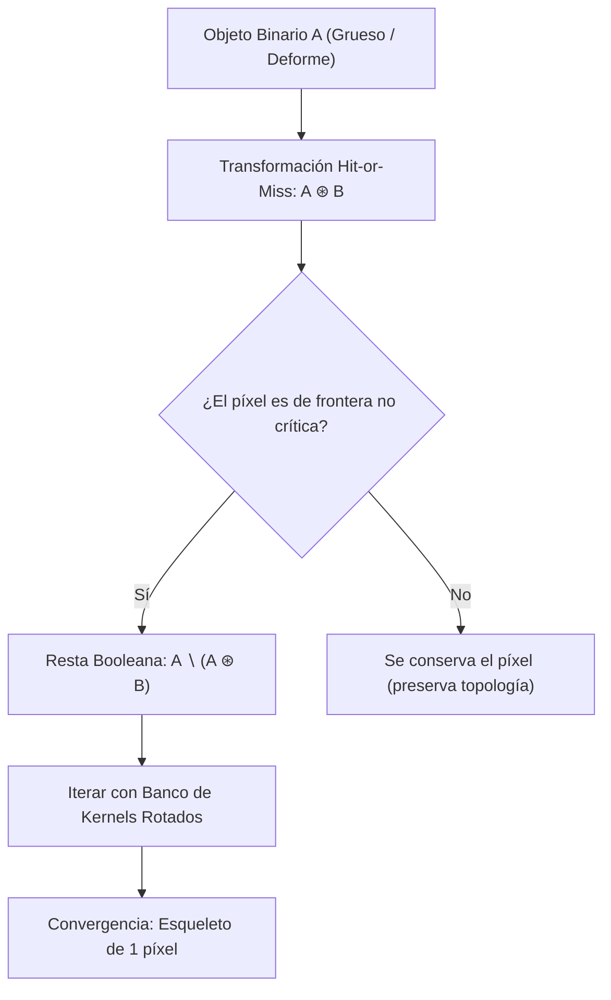

# Adelgazamiento, Espesamiento y Esqueletización

## 🎯 Definición

En análisis de formas y reconocimiento de patrones, el **Adelgazamiento** (*Thinning*) y el **Espesamiento** (*Thickening*) son transformaciones morfológicas iterativas orientadas a modificar el espesor de las regiones binarias **conservando intacta la conectividad y la topología original** de los objetos.

A diferencia de una erosión indiscriminada (que puede destruir componentes finos o partir un objeto en dos partes desconectadas), el adelgazamiento morfológico solo elimina píxeles de frontera que **no alteran las propiedades de homotopía** (es decir, preserva el número de componentes conexas y el número de agujeros interiores).

---

## 🪚 1. Formulación del Adelgazamiento (*Thinning*, $A \otimes B$)

El adelgazamiento de un conjunto $A$ por un elemento estructurante $B$ se define en función de la transformación [[Transformación Hit-or-Miss]]:

$$A \otimes B = A \setminus (A \circledast B) = A \cap (A \circledast B)^c$$

En la práctica, se utiliza una secuencia o banco ordenado de elementos estructurantes $\{B\} = \{ B_1, B_2, \dots, B_n \}$ (típicamente 8 matrices de $3\times 3$ obtenidas rotando un kernel base en pasos de $45^\circ$):

$$A \otimes \{B\} = \left( ( \dots ( (A \otimes B_1) \otimes B_2) \dots ) \otimes B_n \right)$$

El proceso se repite cíclicamente hasta alcanzar la **convergencia** (cuando una pasada completa por los $n$ kernels no elimina ningún píxel adicional: $A_{k} = A_{k-1}$). El resultado es el **esqueleto morfológico** (*medial axis* o esqueleto topológico de 1 píxel de espesor).

---

## 🧱 2. Formulación del Espesamiento (*Thickening*, $A \odot B$)

El espesamiento es la operación dual del adelgazamiento:

$$A \odot B = A \cup (A \circledast B)$$

En lugar de sustraer, el espesamiento agrega píxeles en aquellas posiciones del fondo donde el elemento estructurante $B$ coincide con las restricciones geométricas impuestas.

### Principio de Dualidad:
El espesamiento del objeto $A$ es matemáticamente equivalente al adelgazamiento del fondo $A^c$:

$$(A \odot B)^c = A^c \otimes B$$

Por esta razón, en muchos entornos de visión artificial el espesamiento se implementa directamente adelgazando el fondo de la imagen y complementando el resultado final.

---

## 📱 3. Casos de Estudio Reales

### 3.1. Sensores Biométricos de Huellas Dactilares (Mitigación de Sobrepresión)
- **El problema de la sombra o empastamiento**: Cuando un usuario presiona el dedo con excesiva fuerza contra el prisma óptico o sensor capacitivo de un teléfono móvil, las crestas papilares se aplastan físicamente. El espacio inter-cresta desaparece, produciendo una mancha negra continua y ensanchada ("sombra fea").
- **Solución por Esqueletización**: Al aplicar adelgazamiento morfológico, el algoritmo colapsa la cresta deformada a su línea media axial de **1 píxel de ancho**.
- **Ventaja**: El esqueleto resultante conserva la ubicación idéntica de las bifurcaciones y finales de cresta, independientemente de si la persona apoyó el dedo suavemente o con mucha fuerza.

### 3.2. Cámaras de Tráfico y Reconocimiento de Placas (ALPR / OCR)
- **El reto de la variabilidad de trazo**: En sistemas de foto-multas, las matrículas vehiculares presentan imperfecciones severas: caracteres desgastados, pintura saltada, variaciones de distancia focal o grosores de trazo heterogéneos según el fabricante de la placa.
- **Solución Topológica**: Un clasificador u OCR entrenado sobre el esqueleto morfológico no depende del grosor de la tipografía. Para el carácter **"A"**, la estructura básica consiste en dos ramas inclinadas, un vértice de unión superior y un segmento transversal interior.
- **Resultado**: Aunque la letra "A" esté gruesa, semidespintada o alejada, su esqueleto topológico es único, lo que garantiza una tasa de acierto muy superior frente a la comparación directa de plantillas (*template matching*).

---

## ✂️ 4. Poda Morfológica (*Pruning*)

Durante el proceso de esqueletización, pequeñas irregularidades o asperezas en el contorno del objeto pueden generar ramas parásitas cortas llamadas **espolones** (*spurs*).

La **poda** elimina estos espolones en tres etapas:
1. Detectar los puntos terminales (*endpoints*) de las ramas con un kernel Hit-or-Miss de terminaciones.
2. Eliminar secuencialmente $k$ píxeles de los extremos libres.
3. Reconstruir el tronco principal mediante dilatación condicional para no acortar las ramas estructurales genuinas.

---

## 🔗 Notas Relacionadas
- [[Transformación Hit-or-Miss]] — Operación base para la detección de patrones de borde.
- [[Operaciones Morfológicas Binarias]] — Erosión, dilatación y extracción de bordes.
- [[2026-11-03 - Morfología Matemática - Binaria y Escala de Grises]] — Clase teórica completa.
- [[Morfología Matemática y Hit-or-Miss - Python]] — Implementación práctica en OpenCV.
- [[Inicio]] — Hub principal de la asignatura.
