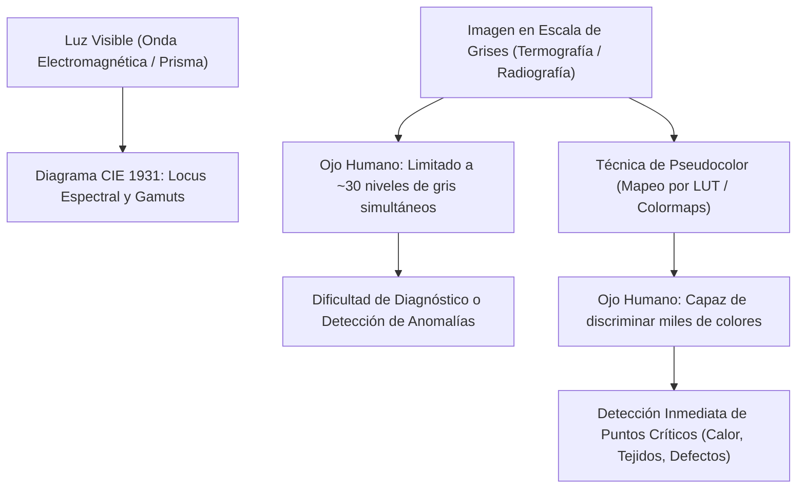

# Diagrama de Cromaticidad CIE y Pseudocolor

## 🎯 Definición

El **Diagrama de Cromaticidad CIE 1931** y las técnicas de **Pseudocolor** (o *Falso Color*) constituyen el puente entre la física ondulatoria de la luz y la psicofísica de la percepción visual humana:

1. **Diagrama CIE 1931**: Es el estándar internacional que mapea cuantitativamente todas las respuestas cromáticas perceptibles por el ojo humano en función de las longitudes de onda del espectro visible.
2. **Pseudocolor**: Es la asignación deliberada de colores cromáticos a intensidades monocromáticas (escala de grises) con el objetivo fundamental de **potenciar la detección de patrones sutiles, anomalías y detalles** que resultarían invisibles al ojo humano en blanco y negro.

---

## 🌈 1. La Luz como Onda y el Diagrama CIE 1931

### 1.1. Naturaleza Física
La luz visible es radiación electromagnética en un rango aproximado de **$380\text{ nm}$ (violeta) a $750\text{ nm}$ (rojo)**. Al atravesar un medio dispersivo (como un prisma de vidrio), las distintas frecuencias se refractan con ángulos diferentes, descomponiéndose en el espectro continuo de colores puros.

### 1.2. Coordenadas de Cromaticidad $(x, y)$
A partir de los valores triestímulo estandarizados $(X, Y, Z)$ definidos por la CIE:
$$x = \frac{X}{X + Y + Z}, \quad y = \frac{Y}{X + Y + Z}, \quad z = \frac{Z}{X + Y + Z}$$
donde $x + y + z = 1$. Con solo especificar $(x, y)$, se define unívocamente la **cromaticidad** (matiz y saturación) con independencia de la luminancia.

### 1.3. Geometría del Diagrama CIE:
- **Locus espectral**: La curva perimetral en forma de herradura que contiene las longitudes de onda monocromáticas puras.
- **Línea de púrpuras**: El segmento recto inferior que cierra la herradura, uniendo el extremo rojo ($700\text{ nm}$) con el extremo violeta ($400\text{ nm}$). Estos colores no existen como longitudes de onda simples en el arcoíris; son mezclas neuronales puras.
- **Punto de blanco equi-energético**: El centro del diagrama $(x, y) = (1/3, 1/3)$.
- **Gamut**: El triángulo formado por tres primarios cualesquiera (como los primarios de un monitor RGB). Ningún monitor o proyector puede reproducir la totalidad de la herradura CIE, solo el polígono encerrado por sus primarios.

---

## 🎨 2. Procesamiento en Pseudocolor (Falso Color)

### 2.1. La Gran Limitación del Ojo Humano
El sistema visual humano posee una adaptación dinámica muy amplia, pero su **capacidad simultánea de discriminación de brillo** es sumamente reducida:
- Un ser humano solo puede distinguir de forma confiable entre **$20$ y $30$ escalones de gris** dentro de una misma escena estática.
- En contraste, el ojo humano puede discriminar **cientos de miles de matices cromáticos y niveles de saturación**.

### 2.2. Principio del Mapeo por Colormaps (LUT)
La técnica básica de pseudocolor asigna a cada nivel de gris $f(x, y) \in [0, 255]$ una terna de colores:
$$f(x, y) \implies \left( R(f(x, y)), \; G(f(x, y)), \; B(f(x, y)) \right)$$

Este mapeo se implementa mediante tres funciones de transformación continuas o una **Tabla de Búsqueda (Look-Up Table - LUT)**:
- Niveles bajos de gris $\to$ Azules y violetas profundos (zonas frías o de baja densidad).
- Niveles medios de gris $\to$ Verdes y cianes (valores de referencia o neutros).
- Niveles altos de gris $\to$ Amarillos, naranjas y rojos incandescentes (zonas críticas, anomalías o alta energía).

---

## 🔬 3. Aplicaciones Reales de Pseudocolor

### 3.1. Termografía Infrarroja e Inspección Eléctrica
- **Problema**: Las cámaras térmicas miden radiación en la banda infrarroja media o lejana (FLIR). En escala de grises, una resistencia o borne eléctrico recalentándose se confunde fácilmente con el gradiente de disipación de la placa metálica.
- **Solución con Pseudocolor**: Al aplicar el mapa **Jet** o **Inferno**, el borne sobrecalentado salta a la vista en color **rojo brillante / amarillo fuego**, permitiendo identificar fallas antes de que ocurra un cortocircuito.

### 3.2. Radiología y Diagnóstico Médico
- En radiografías torácicas, mamografías y tomografías computarizadas (TC):
  - Las densidades óseas, vasos sanguíneos y posibles nódulos tumorales presentan coeficientes de atenuación muy próximos en gris.
  - La colorización por rangos asigna colores contrastantes a umbrales específicos de tejido, acelerando el diagnóstico radiológico.

### 3.3. Teledetección y Cartografía Satelital
- En imágenes multiespectrales (satélites Landsat, Sentinel), bandas invisibles como el infrarrojo cercano (NIR) se combinan en canales RGB para resaltar vegetación sana (índice NDVI en rojo brillante) frente a suelos áridos o cuerpos de agua.

---

## 🔗 Notas Relacionadas
- [[Modelos de Color RGB y CMYK]] — Emisión y absorción en dispositivos de captura y reproducción.
- [[Espacio de Color HSI y Procesamiento Cromático]] — Desacoplamiento de matiz, saturación y brillo.
- [[2026-11-03 - Modelos de Color - RGB, CMYK, HSI y Pseudocolor]] — Clase teórica completa.
- [[Modelos de Color y Pseudocolor - Python]] — Implementación práctica con `cv2.applyColorMap`.
- [[Transformaciones de Intensidad Espacial]] — Funciones de mapeo de intensidades previas.
- [[Inicio]] — Hub principal de la asignatura.
