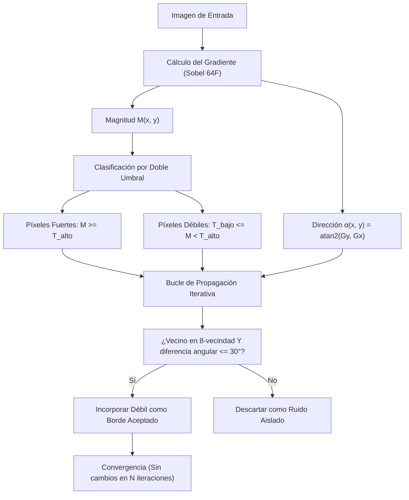

# Enlace Local de Bordes

## 🎯 Definición

El **enlace local de bordes** (*local edge linking*) es una técnica de post-procesamiento en la detección de discontinuidades que conecta píxeles candidatos a borde basándose en su **proximidad espacial (vecindad)** y su **compatibilidad angular (orientación del gradiente)**.

Su propósito central es resolver el dilema de la umbralización simple del gradiente: cerrar contornos discontinuos y recuperar bordes débiles o de bajo contraste sin incorporar ruido aleatorio en la imagen binaria resultante.

---

## 🧠 Idea clave: Borde Local vs Frontera de Objeto

En visión artificial es indispensable distinguir dos nociones:
- **Borde**: Discontinuidad o cambio abrupto en una propiedad local (intensidad, color o textura). Es un concepto meramente local calculado con operadores diferenciales como [[Operadores de Gradiente - Roberts, Prewitt y Sobel|Sobel]].
- **Frontera (*Boundary*)**: Contorno cerrado global que delimita la extensión física de un objeto o región semántica.

> [!warning] La Umbralización Simple Rompe Contornos
> Un operador de gradiente seguido de un umbral global fijo $T$:
> - Si $T$ es **muy bajo**, preserva transiciones suaves pero inunda la imagen de falsos bordes provocados por ruido.
> - Si $T$ es **muy alto**, suprime el ruido pero fragmenta los bordes en rampas suaves o zonas de menor iluminación.

El **enlace local** actúa como un mecanismo de propagación restringida (antecesor directo de la histéresis de Canny): los píxeles fuertes actúan como "anclas de confianza", y los píxeles débiles sólo se validan si están encadenados físicamente a ellos con una dirección compatible.

---

## 🧮 Desarrollo del Algoritmo de Enlace

Dado el cálculo del vector gradiente mediante convolución con máscaras de Sobel en coma flotante (`cv2.CV_64F`):
$$G_x(x, y) = f * S_x, \qquad G_y(x, y) = f * S_y$$
$$\text{Magnitud: } M(x, y) = \sqrt{G_x^2 + G_y^2}$$
$$\text{Dirección: } \alpha(x, y) = \operatorname{atan2}(G_y, G_x)$$

La dirección $\alpha(x, y)$ es ortogonal a la tangente física del contorno del objeto.

### Criterio de Enlace de Dos Puntos:
Un píxel candidato $(x', y')$ en la 8-vecindad de un píxel de borde $(x, y)$ se considera compatible si cumple dos condiciones simultáneas:

1. **Similitud de magnitud**:
   Ambos píxeles poseen magnitud superior a un umbral base $T_{\text{bajo}}$:
   $$M(x', y') \ge T_{\text{bajo}}$$
2. **Coherencia direccional**:
   Las direcciones del gradiente difieren en un valor inferior a una tolerancia angular $\Delta \theta$ (habitualmente $30^\circ$ a $45^\circ$):
   $$|\alpha(x, y) - \alpha(x', y')| \le \Delta \theta \quad \lor \quad |\alpha(x, y) - \alpha(x', y') - 180^\circ| \le \Delta \theta$$

### Procedimiento Iterativo de Propagación:
1. Definir dos umbrales $T_{\text{alto}}$ y $T_{\text{bajo}}$ sobre la magnitud del gradiente.
2. Identificar el conjunto inicial de **bordes fuertes**: $B_0 = \{(x, y) \mid M(x, y) \ge T_{\text{alto}}\}$.
3. Identificar candidatos **débiles**: $C_0 = \{(x, y) \mid T_{\text{bajo}} \le M(x, y) < T_{\text{alto}}\}$.
4. En cada iteración $k$:
   - Para cada píxel en $C_k$, inspeccionar su 8-vecindad en busca de un píxel perteneciente a $B_k$.
   - Si existe un vecino aceptado y el ángulo es coherente ($|\Delta \alpha| \le 30^\circ$), el píxel se promueve a borde: $B_{k+1} = B_k \cup \{(x', y')\}$.
5. Repetir hasta que ningún píxel nuevo sea incorporado (convergencia estable).

---

## 🔍 Ejemplos Numéricos de Laboratorio

En el experimento con un rectángulo sintético cuyos bordes superior, inferior e izquierdo presentan transiciones escalón abruptas, mientras que su borde derecho está compuesto por una **rampa suave**:

| Método aplicado | Franja izquierda (abrupta) | Franja derecha (rampa suave) | Observaciones |
| :--- | :---: | :---: | :--- |
| **Umbral simple ($T = 100$)** | $50.2\%$ detectada | $0.6\%$ detectada | La rampa se pierde casi por completo. |
| **Enlace local iterativo** | $100.0\%$ detectada | **$97.5\%$** detectada | Recuperación casi total del contorno débil. |

- **Umbrales del enlace**: $T_{\text{alto}} = 400$, $T_{\text{bajo}} = 60$, tolerancia angular $\Delta \theta = 30^\circ$.
- **Convergencia**: El algoritmo completó la propagación y convergió en **11 iteraciones**.
- **Comportamiento ante ruido**: Los píxeles de ruido aislados con magnitud entre 60 y 400 fueron descartados exitosamente porque no contaban con una ruta conectada a un borde fuerte.

> [!important] Límite Intrínseco del Enlace Local
> El enlace local necesita una **cadena continua de candidatos intermedios**. Si el borde sufre una discontinuidad o rotura donde no queda ningún píxel con magnitud $\ge T_{\text{bajo}}$, el enlace local no puede inventar información ni saltar el vacío. Para salvar separaciones amplias se requiere un modelo paramétrico global como la [[Transformada de Hough]].

---

## ✅ Conclusión

El enlace local de bordes es una herramienta fundamental de refinamiento que transforma una nube fragmentada de derivadas espaciales en contornos coherentes y continuos. Combina la potencia del análisis local de vecindad con la orientación geométrica del vector gradiente, sirviendo como fase previa indispensable para la segmentación orientada a regiones o la vectorización de contornos.

---

## 🔗 Relacionado

- [[Inicio]]
- [[Derivadas Espaciales en Imágenes]]
- [[Operadores de Gradiente - Roberts, Prewitt y Sobel]]
- [[Transformada de Hough]]
- [[2026-11-04 - Color y Segmentación de Imágenes]]
- [[Segmentación por Bordes y Agrupamiento - Python]]

## 🏷️ Etiquetas

#visión-artificial #detección-de-bordes #gradiente #sobel #enlace-de-bordes #segmentación #procesamiento-de-imágenes
