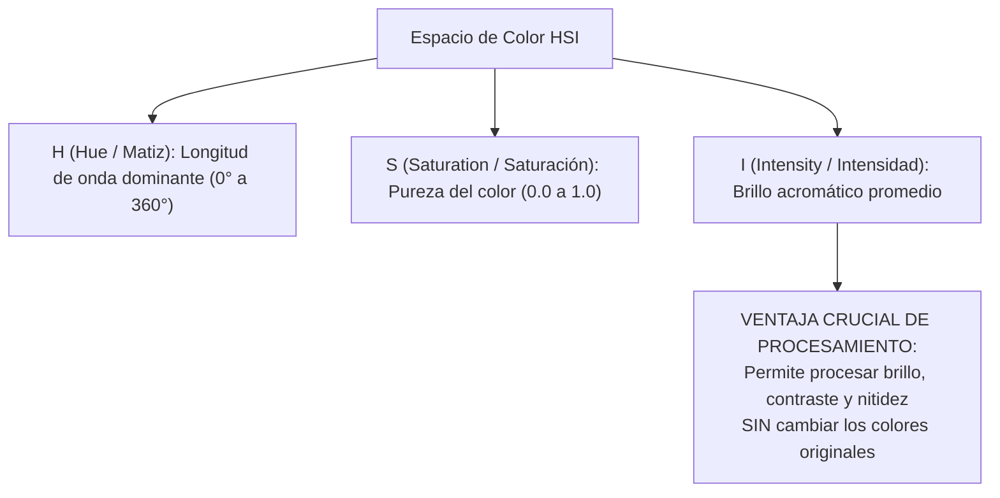

# Espacio de Color HSI y Procesamiento Cromático

## 🎯 Definición

El espacio de color **HSI** (*Hue, Saturation, Intensity* — Matiz, Saturación, Intensidad) es un modelo diseñado para desacoplar la información de **luminancia o brillo** (intensidad) de la información de **crominancia** (matiz y saturación).

A diferencia de los modelos orientados al hardware (como [[Modelos de Color RGB y CMYK]]), el modelo HSI es un **modelo perceptual** que refleja de manera intuitiva el lenguaje y el mecanismo cognitivo con el que los seres humanos describimos e interpretamos los colores.

---

## 🎨 1. Componentes del Modelo HSI

### 1.1. Matiz (*Hue*, $H$)
- Es el atributo visual que permite clasificar un color como rojo, naranja, amarillo, verde, azul o violeta.
- Se cuantifica como un **ángulo** $\theta \in [0^\circ, 360^\circ]$ sobre el círculo cromático:
  - $0^\circ$: Rojo puro
  - $60^\circ$: Amarillo
  - $120^\circ$: Verde puro
  - $180^\circ$: Cian
  - $240^\circ$: Azul puro
  - $300^\circ$: Magenta

### 1.2. Saturación (*Saturation*, $S$)
- Mide el grado de **pureza** del color o su dilución con luz blanca.
- Valores en el rango $[0, 1]$:
  - $S = 1.0$: Color saturado puro y vivo (máximo contraste cromático).
  - $S = 0.0$: Ausencia total de croma; se ubica sobre el eje vertical acromático (escala de grises).

### 1.3. Intensidad (*Intensity*, $I$)
- Magnitud escalar acromática que describe qué tan iluminado o luminoso es el punto, independiente de cuál sea su tonalidad.
- Se calcula como la media aritmética simple de los canales RGB normalizados:
  $$I = \frac{R + G + B}{3}$$

---

## 📐 2. Conversión Matemática de RGB a HSI

Dado un píxel en coordenadas normalizadas $R, G, B \in [0, 1]$:

### 2.1. Cálculo de la Intensidad:
$$I = \frac{1}{3}(R + G + B)$$

### 2.2. Cálculo de la Saturación:
$$S = 1 - \frac{3}{R + G + B} \left[ \min(R, G, B) \right]$$
Si $R + G + B = 0$ (negro puro), entonces $S = 0$.

### 2.3. Cálculo del Matiz:
$$H = \begin{cases} \theta & \text{si } B \le G \\ 360^\circ - \theta & \text{si } B > G \end{cases}$$
donde el ángulo $\theta$ se obtiene mediante:
$$\theta = \arccos \left( \frac{\frac{1}{2}\left[(R - G) + (R - B)\right]}{\sqrt{(R - G)^2 + (R - B)(G - B)}} \right)$$

---

## ⚠️ 3. La Trampa de Procesar Color Directamente en RGB

> [!caution] ¿Por qué "se va todo a la miércoles" al ecualizar en RGB?
> Si se toma una imagen RGB y se aplica una transformación no lineal (como ecualización de histograma, estiramiento de contraste Min-Max o corrección gamma) **por separado sobre cada canal $R$, $G$ y $B$**:
> 1. La ecualización modifica la distribución de cada canal de forma independiente.
> 2. Se rompe la razón de proporcionalidad relativa $\frac{R}{G}$, $\frac{G}{B}$ que define el matiz.
> 3. **Resultado**: El color se corrompe por completo (artefactos de color severos, pieles que mutan a verde, tonos púrpuras o amarillentos antinaturales).

---

## 🛡️ 4. Protocolo Estándar de Procesamiento Cromático en HSI

Para aplicar cualquier técnica de realce espacial o de intensidad sin alterar los colores:

1. **Conversión de Espacio**:
   $$\text{Imagen}_{RGB} \xrightarrow{\text{Transformada}} \text{Imagen}_{HSI}$$
2. **Aislamiento**:
   Separar los tres canales matriciales: $H$, $S$ e $I$.
3. **Procesamiento Exclusivo sobre la Luminancia**:
   Aplicar la operación únicamente sobre el canal de Intensidad:
   $$I_{\text{nuevo}} = T(I)$$
   *(donde $T$ puede ser ecualización de histograma, filtro pasa-altas, máscara de desenfoque, etc.)*.
4. **Recombinación e Inversión**:
   $$\text{Tupla } (H, S, I_{\text{nuevo}}) \xrightarrow{\text{Transformada Inversa}} \text{Imagen}_{RGB}^*$$

**Resultado final**: El contraste se amplía, la imagen adquiere mayor nitidez y los colores originales permanecen $100\%$ fieles y consistentes.

---

## 🔗 Notas Relacionadas
- [[Modelos de Color RGB y CMYK]] — Fundamentos aditivos y sustractivos.
- [[Diagrama de Cromaticidad CIE y Pseudocolor]] — Locus espectral y falso color.
- [[2026-11-03 - Modelos de Color - RGB, CMYK, HSI y Pseudocolor]] — Sesión teórica completa.
- [[Modelos de Color y Pseudocolor - Python]] — Laboratorio práctico con OpenCV y scripts ejecutables.
- [[Histogramas y Ecualización de Imagen]] — Algoritmos de contraste aplicables al canal $I$.
- [[Inicio]] — Hub principal de la asignatura.
