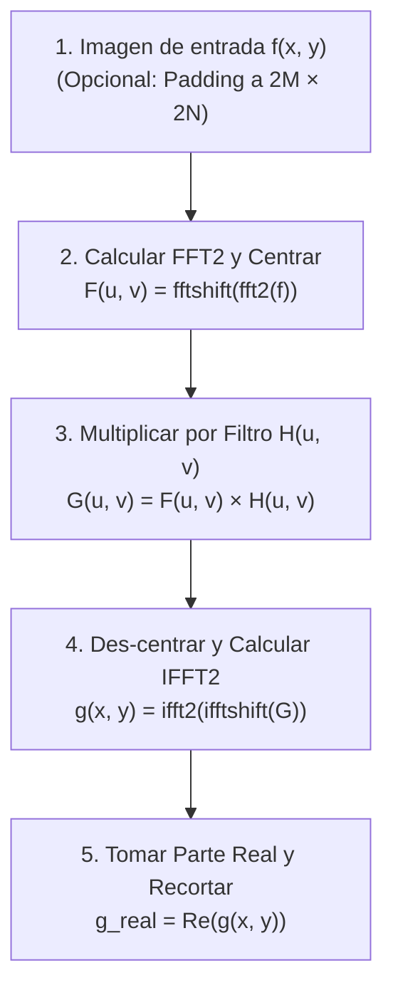

# Filtrado en el Dominio de la Frecuencia

## 🎯 Definición

El **Filtrado en el Dominio de la Frecuencia** consiste en modificar selectivamente las componentes del espectro de Fourier de una imagen mediante una **función de transferencia $H(u, v)$**, aprovechando el **Teorema de la Convolución**:

$$ f(x, y) * h(x, y) \quad \Longleftrightarrow \quad F(u, v) \cdot H(u, v) $$

La convolución espacial bidimensional se reduce a una simple **multiplicación punto a punto** en el plano de frecuencias.

---

## 🔁 Procedimiento Estándar de Filtrado (5 Pasos)

---

## 🎛️ Clasificación de Filtros según su Función de Transferencia $H(u, v)$

Sean $D(u, v) = \sqrt{(u - M/2)^2 + (v - N/2)^2}$ la distancia euclidiana al centro del espectro, y $D_0$ la frecuencia de corte:

### 1. Filtros Pasa-Bajas (*Low-Pass Filters* - LPF)
Atenúan las altas frecuencias manteniendo las bajas frecuencias intactas ($H \approx 1$ cerca del centro, $H \to 0$ lejos).
* **Efecto visual:** Suavizado espacial, difuminado (*blur*), eliminación de ruido de grano fino.
* **Tipos principales:**
  - **Ideal (ILPF):** Corte abrupto en $D_0$. Genera severo artefacto de oscilación o *ringing* (fenómeno de Gibbs).
  - **Gaussiano (GLPF):** $H(u, v) = e^{-\frac{D^2(u, v)}{2D_0^2}}$. Completamente suave; **cero efecto ringing**.
  - **Butterworth (BLPF):** Transición intermedia controlada por el orden $n$.

### 2. Filtros Pasa-Altas (*High-Pass Filters* - HPF)
Atenúan las bajas frecuencias y dejan pasar las altas ($H \approx 0$ cerca del centro, $H \to 1$ lejos).
* **Relación matemática:**
  $$ H_{HP}(u, v) = 1 - H_{LP}(u, v) $$
* **Efecto visual:** Elimina las zonas de intensidad constante o variación lenta (ej. borra cielos planos y fondos uniformes) y **resalta aristas, bordes finos y detalles geométricos**.

---

## 🎯 Eliminación de Ruido Periódico: Filtros Notch (Muesca)

El ruido periódico proviene de interferencias repetitivas de origen electromagnético (motores, red de 60 Hz, líneas de barrido de sensores).

### ¿Por qué Fourier es imbatible ante el Ruido Periódico?
* En el dominio espacial, el ruido contamina cada uno de los píxeles de la imagen.
* En el dominio frecuencial, una señal sinusoidal periódica se manifiesta como **un par de impulsos puntuales brillantes simétricos respecto al origen**: $(u_0, v_0)$ y $(-u_0, -v_0)$.
* **Filtro Rechaza-Banda Notch:**
  Diseñamos una máscara que valga $1$ en toda la matriz excepto en radios pequeños alrededor de las coordenadas del ruido:
  $$ H_{notch}(u, v) = \begin{cases} 0 & \text{si } D_1(u, v) \le D_0 \text{ o } D_2(u, v) \le D_0 \\ 1 & \text{en el resto} \end{cases} $$
* Al multiplicar $F(u, v) \cdot H_{notch}(u, v)$ y regresar con la IFFT, **el patrón de interferencia periódica desaparece por completo sin afectar los bordes ni la textura del resto de la escena**.

---

## 🔗 Relacionado

- [[Dominio de la Frecuencia y Transformada de Fourier]]
- [[Magnitud y Fase en Fourier]]
- [[Filtros de Suavizado Espacial]]
- [[Transformada de Fourier y Filtrado en Frecuencia - Python]]
