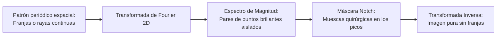

# Filtros Notch y Rechaza Banda

## 🎯 Definición y Naturaleza del Ruido Periódico

El **ruido periódico o cíclico** se manifiesta en el dominio espacial como patrones geométricos repetitivos (rayas, franjas sinusoidales o mallas cuadriculadas), producidos usualmente por interferencias eléctricas, mecánicas o acoples de fuentes de alimentación durante la captura.

En el **dominio de la frecuencia**, una sinusoide espacial se traduce en **picos de energía brillantes (impulsos) aislados y perfectamente localizables**.

---

## 🔬 Anatomía del Espectro y Reglas de Oro

1. **La Componente DC ($u=0, v=0$):**
   * En el espectro centrado (`fftshift`), el centro $(M/2, N/2)$ representa el **promedio de iluminación global** de la escena.
   * **Regla cardinal:** **Nunca debe atenuarse el centro.** Cualquier filtro notch debe ubicarse estrictamente en frecuencias medias o altas fuera del origen.
2. **Simetría Conjugada de Pares:**
   * Dado que las imágenes del mundo real están compuestas por números reales, su transformada de Fourier posee simetría hermítica:
     $$ F(-u, -v) = F^*(u, v) \implies |F(-u, -v)| = |F(u, v)| $$
   * Por cada pico de ruido en $(u_k, v_k)$, existe un **pico gemelo en $(-u_k, -v_k)$**. Un filtro notch debe aplicar muescas en **ambos puntos simultáneamente**.

---

## 🧮 Formulación Matemática del Filtro Notch de Rechazo

Sean las distancias desde el punto $(u, v)$ hacia los centros de la muesca $k$-ésima:

$$ D_k(u, v) = \sqrt{\left(u - \frac{M}{2} - u_k\right)^2 + \left(v - \frac{N}{2} - v_k\right)^2} $$
$$ D_{-k}(u, v) = \sqrt{\left(u - \frac{M}{2} + u_k\right)^2 + \left(v - \frac{N}{2} + v_k\right)^2} $$

donde $D_0$ es el radio de corte de la muesca.

---

### 1. Filtro Notch Ideal de Rechazo (NRF)
Corta a cero de forma abrupta dentro del radio $D_0$:

$$ H(u, v) = \begin{cases} 0 & \text{si } D_k(u, v) \le D_0 \text{ o } D_{-k}(u, v) \le D_0 \\ 1 & \text{en cualquier otro caso} \end{cases} $$

- **Inconveniente:** Produce oscilaciones fantasma (*ringing*) en la imagen restaurada.

---

### 2. Filtro Notch Butterworth de Rechazo
Introduce una pendiente suave de orden $n$:

$$ H(u, v) = \prod_{k=1}^Q \left[ \frac{1}{1 + \left( \frac{D_0}{D_k(u, v)} \right)^{2n}} \right] \left[ \frac{1}{1 + \left( \frac{D_0}{D_{-k}(u, v)} \right)^{2n}} \right] $$

- **Ventaja:** Excelente equilibrio: elimina la frecuencia espuria y permite regular la agresividad del corte mediante el orden $n$ sin generar ringing excesivo.

---

### 3. Filtro Notch Gaussiano de Rechazo
Suavidad asintótica perfecta:

$$ H(u, v) = \prod_{k=1}^Q \left[ 1 - e^{-\frac{1}{2} \left( \frac{D_k(u, v)}{D_0} \right)^2} \right] \left[ 1 - e^{-\frac{1}{2} \left( \frac{D_{-k}(u, v)}{D_0} \right)^2} \right] $$

- **Ventaja:** **Cero ringing garantizado**. Transición absolutamente suave en el dominio espacial.

---

## ⚖️ Filtro Notch vs Filtro Rechaza Banda (*Bandreject*)

| Criterio | Filtro Notch de Rechazo | Filtro Rechaza Banda (*Bandreject*) |
| :--- | :--- | :--- |
| **Geometría de la máscara** | Puntos / muescas localizadas | Anillo circular continuo $360^\circ$ |
| **Selectividad** | **Quirúrgica** (solo frecuencias de ruido) | Gruesa (toda una banda radial) |
| **Preservación de detalles** | **Máxima** (no toca frecuencias útiles) | Regular (elimina información válida) |
| **Uso ideal** | Rayas con dirección y frecuencia fija | Ruido periódico isotrópico en todas direcciones |

---

## 🔗 Relacionado

- [[Reducción de Ruido Aditivo y Espacial]] — métodos en el dominio espacial
- [[Dominio de la Frecuencia y Transformada de Fourier]] — conceptos de espectro, magnitud y fase
- [[Filtrado en el Dominio de la Frecuencia]] — filtros pasa-bajas y pasa-altas en 2D
- [[2026-10-28 - Reducción de Ruido Aditivo y Cíclico]] — clase teórica
- [[Reducción de Ruido Aditivo y Filtros Notch - Python]] — implementación práctica
- [[Inicio]] — mapa general de la materia

---

## 🏷️ Etiquetas

#visión-artificial #procesamiento-de-imágenes #dominio-de-la-frecuencia #filtros-notch #ruido-periódico #fourier #filtros-rechaza-banda
