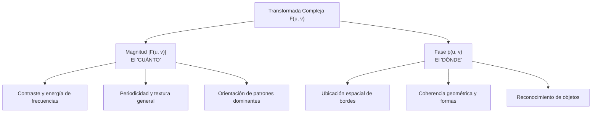

# Magnitud y Fase en Fourier

## 🎯 Definición

La Transformada Discreta de Fourier de una imagen real entrega una matriz de números complejos:
$$ F(u, v) = R(u, v) + j I(u, v) $$

Expresada en coordenadas polares:
$$ F(u, v) = |F(u, v)| e^{j \phi(u, v)} $$

donde:
1. **$|F(u, v)|$ es la Magnitud (o Espectro de Fourier):**
   $$ |F(u, v)| = \sqrt{R(u, v)^2 + I(u, v)^2} $$
2. **$\phi(u, v)$ es el Ángulo de Fase:**
   $$ \phi(u, v) = \arctan\left( \frac{I(u, v)}{R(u, v)} \right) $$

---

## ⚖️ El "Cuánto" vs. el "Dónde"

| Componente | Qué contiene | Interpretación en la Imagen |
| :--- | :--- | :--- |
| **Magnitud** | La cantidad de energía presente en cada frecuencia espacial. | Determina si la imagen tiene mucho o poco contraste en ciertas frecuencias, si hay patrones repetitivos o texturas periódicas. |
| **Fase** | El desfase relativo entre las ondas sinusoidales. | Determina **dónde interfieren constructivamente las ondas** para dar origen a las líneas, bordes, esquinas y siluetas reconocibles de los objetos. |

---

## 🔬 Experimento Canónico de Reconstrucción Cruzada (Oppenheim & Lim)

Supongamos dos imágenes distintas: una imagen de un **Rostro Humano ($A$)** y una imagen de un **Paisaje / Edificio ($B$)**:

1. Calculamos sus transformadas de Fourier:
   $$ F_A = |F_A| e^{j \phi_A}, \qquad F_B = |F_B| e^{j \phi_B} $$
2. Realizamos una mezcla cruzada:
   $$ F_{híbrido} = |F_B| e^{j \phi_A} \quad \text{(Magnitud del Paisaje + Fase del Rostro)} $$
3. Calculamos la Transformada Inversa $\mathcal{F}^{-1}\{F_{híbrido}\}$:

> [!important] Resultado Sorprendente
> **La imagen reconstruida muestra claramente el Rostro Humano ($A$), con un ligero matiz de contraste o textura del Paisaje ($B$).**
> Si por el contrario se combina la Magnitud del Rostro con la Fase del Paisaje, se observará el Paisaje.

### Conclusión Teórica:
* **La fase es el portador primario de la inteligibilidad estructural:** El cerebro humano reconoce las formas gracias a las relaciones de fase entre armónicos.
* Si se anula la fase ($\phi(u, v) = 0$, conservando solo la magnitud), la imagen se convierte en una masa irreconocible de círculos concéntricos y simetrías difusas.

---

## 🔗 Relacionado

- [[Dominio de la Frecuencia y Transformada de Fourier]]
- [[Filtrado en el Dominio de la Frecuencia]]
- [[2026-10-21 - Introducción al Dominio de la Frecuencia y Transformada de Fourier]]
- [[Transformada de Fourier y Filtrado en Frecuencia - Python]]
