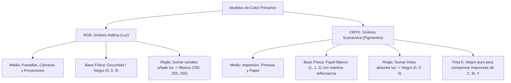

# Modelos de Color RGB y CMYK

## 🎯 Definición

Un **modelo de color** (o espacio de color) es una especificación matemática abstracta que describe la manera en que los colores pueden representarse como tuplas de números (típicamente de 3 o 4 componentes).

Los dos modelos de referencia tecnológica más importantes son:
1. **RGB (Red, Green, Blue)**: Modelo de **síntesis aditiva**.
2. **CMYK (Cyan, Magenta, Yellow, Key/Black)**: Modelo de **síntesis sustractiva**.

---

## 🔴🟢🔵 1. Modelo RGB (Síntesis Aditiva)

### 1.1. Principio Físico y Emisión
El modelo RGB se basa en la **teoría tricromática de Young-Helmholtz**, según la cual el sistema visual humano reconstruye la totalidad del espectro a partir de la estimulación de tres clases de conos retinianos ($L, M, S$).

- En dispositivos electrónicos (pantallas OLED, monitores LED y proyectores), cada píxel consta de una tríada de subpíxeles emisores de luz roja ($\approx 700\text{ nm}$), verde ($\approx 546\text{ nm}$) y azul ($\approx 435\text{ nm}$).
- **El punto de origen es el negro absoluto** (cuando los subpíxeles están totalmente apagados: $R = 0, G = 0, B = 0$).
- A medida que incrementamos las intensidades luminosas, la luz emitida se suma en la retina:
  $$\text{Rojo} + \text{Verde} = \text{Amarillo}$$
  $$\text{Verde} + \text{Azul} = \text{Cian}$$
  $$\text{Azul} + \text{Rojo} = \text{Magenta}$$
  $$\text{Rojo} + \text{Verde} + \text{Azul} = \text{Blanco}$$

### 1.2. Representación en el Cubo RGB
Matemáticamente, el espacio RGB normalizado se representa como un **cubo unitario tridimensional** $[0, 1]^3$:
- El origen $(0, 0, 0)$ corresponde al Negro.
- El vértice opuesto $(1, 1, 1)$ corresponde al Blanco.
- La diagonal principal que conecta $(0,0,0)$ con $(1,1,1)$ define la **línea de escala de grises acromáticos** ($R = G = B$).
- Los restantes 6 vértices corresponden a los primarios (Rojo, Verde, Azul) y secundarios (Cian, Magenta, Amarillo).

---

## 🖨️ 2. Modelo CMYK (Síntesis Sustractiva)

### 2.1. Principio Físico y Absorción
El modelo CMY/CMYK rige los procesos de impresión y artes gráficas donde la luz no se emite, sino que se **refleja sobre un sustrato**.

- **El punto de partida es el papel blanco**, cuya superficie posee la máxima reflectancia lumínica del entorno.
- Las tintas de color actúan como **filtros ópticos absorbedores**:
  - El pigmento **Cian** absorbe la luz roja y refleja verde y azul.
  - El pigmento **Magenta** absorbe la luz verde y refleja rojo y azul.
  - El pigmento **Amarillo** absorbe la luz azul y refleja rojo y verde.
- Al depositar sucesivas capas de tintas sobre el papel, cada una **sustrae** una porción del espectro reflejado.
- La superposición teórica de Cian, Magenta y Amarillo absorbe todas las longitudes de onda visibles, produciendo negro:
  $$\begin{bmatrix} C \\ M \\ Y \end{bmatrix} = \begin{bmatrix} 1 \\ 1 \\ 1 \end{bmatrix} - \begin{bmatrix} R \\ G \\ B \end{bmatrix}$$

### 2.2. ¿Por qué es Indispensable la Tinta "K" (Key / Negro)?
En la imprenta real no se utiliza únicamente CMY, sino **CMYK**:
1. **Impurezas químicas**: Los pigmentos comerciales de cian, magenta y amarillo no son perfectamente puros; al mezclarse al 100%, absorben desigualmente y producen un tono **marrón turbio o grisáceo**, nunca un negro denso.
2. **Saturación del soporte**: Aplicar tres tintas simultáneas al $100\%$ empapa y deforma el papel, tardando demasiado tiempo en secar.
3. **Costo económico**: La tinta negra a base de carbón es mucho más económica que las tintas cromáticas de color.

---

## 📊 Tabla Comparativa Resumen

| Característica | Modelo RGB | Modelo CMYK |
| :--- | :--- | :--- |
| **Naturaleza** | **Aditiva** (Suma de emisiones lumínicas) | **Sustractiva** (Absorción de luz reflejada) |
| **Medio de Aplicación** | Pantallas, Monitores, Sensores, Web | Impresión sobre papel, Litografía, Prensa |
| **Estado Base Inicial** | Negro (Ausencia total de luz) | Blanco (Máxima luminosidad del papel) |
| **Efecto de Sumar Canales** | Se acerca progresivamente al **Blanco** | Se acerca progresivamente al **Negro** |
| **Componentes Primarios** | Rojo, Verde, Azul ($3$ canales) | Cian, Magenta, Amarillo, Negro Key ($4$ tintas) |
| **Sensibilidad Hardware** | Lineal con la tensión o voltaje de los LEDs | No lineal (afectado por porosidad y ganancia de punto) |

---

## 🔗 Notas Relacionadas
- [[2026-11-03 - Modelos de Color - RGB, CMYK, HSI y Pseudocolor]] — Clase teórica detallada.
- [[Espacio de Color HSI y Procesamiento Cromático]] — Modelo perceptual desacoplado.
- [[Diagrama de Cromaticidad CIE y Pseudocolor]] — Locus espectral y mapas térmicos.
- [[Modelos de Color y Pseudocolor - Python]] — Laboratorio práctico con OpenCV y NumPy.
- [[Inicio]] — Hub principal de la asignatura.
