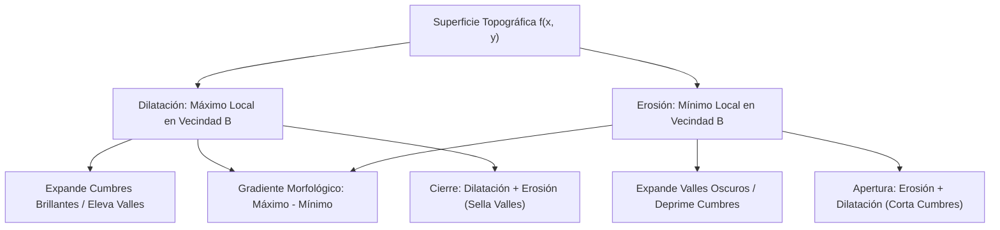
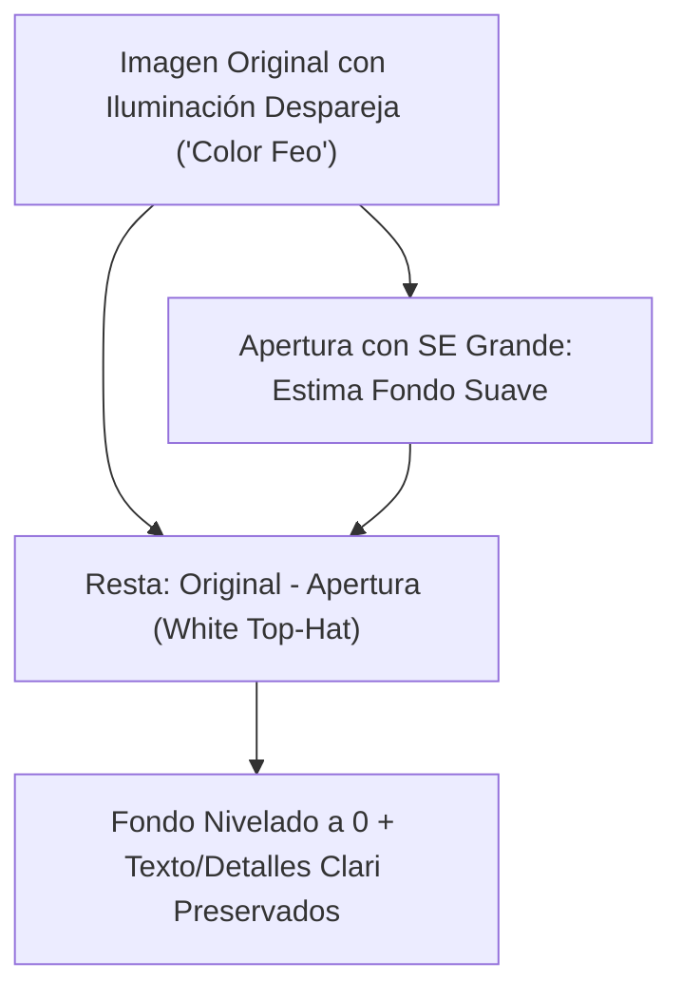

# Morfología en Escala de Grises

## 🎯 Definición y Modelo Topográfico

La **Morfología en Escala de Grises** extiende los conceptos morfológicos binarios a funciones de intensidad continuas o discretas $f(x, y) \in [0, L-1]$.

En lugar de modelar la imagen como un conjunto plano bidimensional de píxeles encendidos o apagados, la imagen en escala de grises se interpreta como una **superficie topográfica 3D**:
- Las coordenadas $(x, y)$ definen la posición en el mapa geográfico.
- La intensidad del píxel $f(x, y)$ representa la **elevación, cota o altitud $z$** sobre el plano.
- Las regiones de alta intensidad (claras o brillantes) constituyen **cumbres, colinas, crestas o mesetas**.
- Las regiones de baja intensidad (oscuras) representan **valles, cañones, cuencas o depresiones**.

---

## 📊 Comparativo Fundamental: Dominio Binario vs Dominio de Grises

| Operación | Dominio Binario ($\mathbb{Z}^2$) | Dominio de Escala de Grises ($\mathbb{Z}^2 \times \mathbb{R}$) |
| :--- | :--- | :--- |
| **Naturaleza** | Teoría de Conjuntos | Superficies Topográficas |
| **Dilatación** | **Unión** de traslaciones ($\bigcup$) | **Máximo Local** ($\max$) |
| **Erosión** | **Intersección** de traslaciones ($\bigcap$) | **Mínimo Local** ($\min$) |
| **Efecto Visual Dilatación** | Engrosa regiones blancas | Aumenta el brillo global, expande elementos claros |
| **Efecto Visual Erosión** | Adelgaza regiones blancas | Oscurece la imagen, expande elementos oscuros |
| **Apertura** | Elimina islas de ruido exterior | Suprime picos brillantes pequeños menores que $B$ |
| **Cierre** | Rellena agujeros internos | Rellena depresiones o cuencas oscuras menores que $B$ |

---

## 📐 1. Formulación con Elementos Estructurantes Planos

En la gran mayoría de aplicaciones prácticas de visión artificial, se utilizan **elementos estructurantes planos** (donde la función del kernel $b(s, t) = 0$ para todo $(s, t) \in B$).

### 1.1. Dilatación en Grises ($f \oplus b$)
Calcula el **máximo local** de la imagen dentro de la vecindad definida por el elemento estructurante:

$$(f \oplus b)(x, y) = \max_{(s, t) \in B} \{ f(x - s, y - t) \}$$

- Las mesetas y picos brillantes se ensanchan espacialmente.
- Los valles oscuros y grietas se rellenan o elevan su piso hacia el valor de los vecinos más claros.

### 1.2. Erosión en Grises ($f \ominus b$)
Calcula el **mínimo local** de la imagen dentro de la vecindad definida por el elemento estructurante:

$$(f \ominus b)(x, y) = \min_{(s, t) \in B} \{ f(x + s, y + t) \}$$

- Los picos brillantes se erosionan (se reducen en área o disminuyen su altura).
- Los valles oscuros se ensanchan, ganando terreno hacia las pendientes adyacentes.

---

## 🧼 2. Apertura y Cierre en Escala de Grises

### 2.1. Apertura Morfológica ($f \circ b$)
$$f \circ b = (f \ominus b) \oplus b$$
- **Interpretación física**: Equivale a hacer rodar una esfera o sonda rígida $b$ por **debajo** de la superficie topográfica. La apertura conserva todos los accidentes del terreno donde la sonda cabe, eliminando los picos brillantes afilados donde la sonda no puede entrar.
- **Utilidad**: Eliminación de ruido impulsivo de alta intensidad (ruido de sal) preservando la geometría de regiones grandes.

### 2.2. Cierre Morfológico ($f \bullet b$)
$$f \bullet b = (f \oplus b) \ominus b$$
- **Interpretación física**: Equivale a hacer rodar la sonda rígida $b$ por **encima** de la superficie topográfica. La sonda se desliza sobre las cumbres y no puede descender al fondo de grietas estrechas, puenteando y sellando las depresiones oscuras.
- **Utilidad**: Eliminación de ruido impulsivo de baja intensidad (ruido de pimienta) y unificación de texturas.

---

## 📈 3. Gradiente Morfológico y Filtros de Resalte

### 3.1. Gradiente Morfológico
Diferencia punto a punto entre la dilatación y la erosión:

$$G(f) = (f \oplus b) - (f \ominus b) = \text{Máximo Local} - \text{Mínimo Local}$$

- En zonas de intensidad homogénea: $\max \approx \min \implies G(f) \approx 0$ (fondo negro).
- En zonas de transición de intensidad (bordes): la diferencia entre el máximo del lado claro y el mínimo del lado oscuro genera una cresta brillante que delimita el contorno exacto.

### 3.2. Transformaciones Top-Hat y Black-Hat
Permiten corregir fondos con **iluminación no uniforme**, eliminar sombras indeseadas y aislar texto o texturas sobre fondos desparejos:

1. **White Top-Hat (Por apertura)**:
   $$T_{\text{white}}(f) = f - (f \circ b)$$
   Resta a la imagen original $f$ su apertura morfológica. Como la apertura con un kernel grande "borra" los detalles angostos y retiene las colinas suaves de iluminación del fondo, la resta suprime dicho fondo y aísla los elementos más claros que su vecindad circundante.
2. **Black-Hat (Por cierre)**:
   $$T_{\text{black}}(f) = (f \bullet b) - f$$
   Resta a la imagen original su versión cerrada. Como el cierre rellena las cuencas o depresiones oscuras, al restarle la original al cierre se aísla el contenido de los valles (elementos oscuros como texto negro o grietas sobre fondo claro), dando como resultado una imagen donde el fondo se aplana y los detalles oscuros quedan destacados.

### 3.3. Aplicación Industrial: Rescate de Texto y Nivelación de Fondo
En escaneos de documentos o lectura de matrículas donde existe una gama de colores compleja o sombras diagonales severas ("color feo"):
- La **binarización estándar falla** porque el umbral global manda a negro todo el texto que cayó dentro de la sombra.
- Al calcular $T_{\text{white}}(f)$ o $T_{\text{black}}(f)$, la morfología desacopla la baja frecuencia espacial del fondo (la sombra continua) de la alta frecuencia espacial del trazo tipográfico.
- La resta aplana el fondo a un valor constante, permitiendo umbralizar o procesar la imagen con éxito total.

---

## 🏔️ 4. La Síntesis: Del Cubo Booleano a la Superficie Topográfica

> [!quote] Visión Integradora
> - En **procesamiento binario**, las operaciones se conciben como el desplazamiento dentro de un **cubo o retículo booleano** donde las decisiones son estrictas: pertenencia o no pertenencia a un conjunto $\{0, 1\}$.
> - En **escala de grises**, nos desplazamos a través de una **sección topográfica tridimensional** compuesta de cumbres, pendientes, collados y valles.
> - Así como en el **dominio de la frecuencia** analizábamos picos de Fourier y en el **histograma** inspeccionábamos valles entre cúmulos de distribución para separar clases, en la **morfología en niveles de gris** la propia matriz espacial de la imagen es el relieve geográfico directo que exploramos con la sonda morfológica.

---

## 🔗 Notas Relacionadas
- [[Operaciones Morfológicas Binarias]] — Fundamento binario y principio de dualidad.
- [[Adelgazamiento, Espesamiento y Esqueletización]] — Reducción topológica y preservación de conectividad.
- [[2026-11-03 - Morfología Matemática - Binaria y Escala de Grises]] — Sesión teórica completa.
- [[Morfología Matemática y Hit-or-Miss - Python]] — Implementación práctica con OpenCV (`cv2.morphologyEx`).
- [[Transformaciones de Intensidad Espacial]] — Tratamiento clásico de contraste e iluminación.
- [[Inicio]] — Hub principal de la asignatura.
