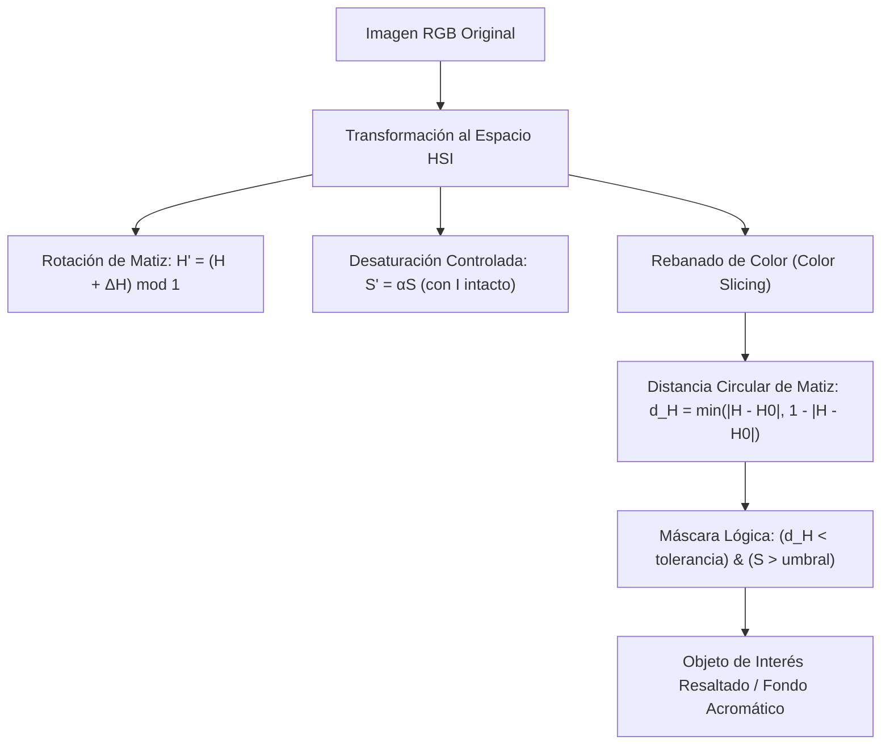

# Rebanado de Color y Operaciones Cromáticas

## 🎯 Definición

El **rebanado de color** (*color slicing*) y las **operaciones cromáticas directas** son técnicas de procesamiento a todo color diseñadas para aislar, transformar o resaltar regiones específicas de una imagen basándose en sus propiedades cromáticas (matiz y saturación) en lugar de depender únicamente de la intensidad.

A diferencia del [[Diagrama de Cromaticidad CIE y Pseudocolor|pseudocolor]] (que asigna colores arbitrarios a una imagen monocromática), el procesamiento a todo color opera sobre imágenes RGB reales, transformando o filtrando sus componentes vectoriales para segmentar objetos cromáticamente distinguibles o modificar su gama tonal.

---

## 🧠 Idea clave: Espacio HSI y la Naturaleza Circular del Matiz

Para manipular el color sin corromper la apariencia física de la escena:
1. Se desacopla la luminancia de la crominancia convirtiendo de RGB a [[Espacio de Color HSI y Procesamiento Cromático|HSI]].
2. El canal de matiz ($H$) es **periódico y angular** ($0^\circ \equiv 360^\circ$ o $[0, 1)$ normalizado). Por tanto, la distancia euclidiana estándar no funciona en las proximidades del rojo puro ($0^\circ$ / $360^\circ$).
3. Para medir la cercanía entre un matiz $H$ y un matiz de referencia $H_0$ se utiliza la **distancia circular mínima**:
   $$d_H(H, H_0) = \min\bigl(|H - H_0|, \, 1 - |H - H_0|\bigr)$$
4. La selección de color exige verificar simultáneamente una **saturación mínima** ($S > S_{\min}$). En píxeles acromáticos (grises o blancos donde $R \approx G \approx B$), el matiz es matemáticamente inestable o indefinido y carece de significado cromático perceptible.

---

## 🧮 Desarrollo de Operaciones Cromáticas

### 1. Complemento o Negativo de Color
En imágenes de 8 bits por canal, el complemento invierte la absorción de luz en cada componente manteniendo la posición espacial:
$$(R', G', B') = (255 - R, \; 255 - G, \; 255 - B)$$
Por ejemplo, el rojo puro $(255, 0, 0)$ se convierte en cian puro $(0, 255, 255)$.

### 2. Rotación de Matiz (*Hue Rotation*)
Permite cambiar la paleta de colores de una escena conservando la saturación ($S$) y la intensidad ($I$) de cada píxel:
$$H' = (H + \Delta H) \bmod 1.0$$
- Un desplazamiento de $+120^\circ$ ($\Delta H = 120/360 \approx 0.333$) transforma el rojo en verde y el verde en azul.
- Al reconstruir RGB, los tres canales se recalculan de forma coherente. En pruebas numéricas, un rojo $(255, 0, 0)$ rotado $120^\circ$ genera $(0, 254, 0)$, donde la pequeña discrepancia frente a 255 se debe al redondeo a enteros en la conversión inversa.

### 3. Reducción de Saturación (*Desaturación*)
Se escala la pureza cromática mediante un factor constante $\alpha \in [0, 1]$:
$$S' = \alpha S$$
- Si $\alpha = 1$, el color permanece idéntico.
- Si $\alpha = 0$, la imagen se desatura por completo convirtiéndose en una representación en escala de grises donde $R = G = B = I$.
- **Propiedad fundamental**: Reducir $S$ no requiere alterar $I$. La luminancia de la escena se conserva de forma idéntica.

### 4. Rebanado de Color (*Color Slicing*)
El objetivo es aislar una región cromática específica (por ejemplo, un objeto rojo) y neutralizar el resto de la escena a escala de grises:
1. Convertir la imagen a HSI.
2. Calcular la distancia circular respecto al matiz objetivo $H_0$ (con $H_0 = 0.0$ para rojo):
   $$d_H = \min\bigl(|H - H_0|, \, 1 - |H - H_0|\bigr)$$
3. Construir la máscara binaria con una tolerancia angular $\Delta H_{\text{tol}}$ (por ejemplo $15^\circ / 360^\circ$) y un filtro de saturación para descartar fondos grises:
   $$\text{Máscara}(x, y) = \bigl(d_H(x, y) < \Delta H_{\text{tol}}\bigr) \land \bigl(S(x, y) > S_{\text{umbral}}\bigr)$$
4. En los píxeles donde la máscara es verdadera, se conserva el color RGB original; donde es falsa, se reemplaza por el valor de intensidad $I$ replicado en los tres canales.

### 5. Filtrado Espacial en HSI vs Filtrado Directo en RGB
Al suavizar una imagen RGB canal por canal con un filtro de caja o Gaussiano, en los bordes entre regiones de colores complementarios (como rojo y verde) se genera un tono amarillento espurio que no existía en la escena original.
- **Protocolo seguro**: Convertir a HSI, aplicar el suavizado o realce espacial **exclusivamente sobre el canal $I$**, y recombinar con los canales $H$ y $S$ originales antes de retornar a RGB.
- **Precaución**: El filtro Gaussiano suaviza y reduce ruido, mientras que las derivadas espaciales (como el Laplaciano) realzan bordes y altas frecuencias. Las conversiones sucesivas de ida y vuelta presentan un error numérico medio residual ($\approx 0.267$ niveles de gris por canal en 8 bits).

---

## 🔍 Ejemplos Numéricos de Laboratorio

En una escena sintética de prueba compuesta por un círculo rojo ($r = 50$, centrado en $(100, 100)$), un rectángulo azul y un fondo gris neutro:
- **Área teórica continua**: $A = \pi r^2 = \pi (50)^2 \approx 7853.98\text{ px}$.
- **Área discreta recuperada por la máscara**: $7845\text{ px}$.
- **Error relativo de discretización**: $\approx 0.1\%$.
- **Falsos positivos en rectángulo azul**: $0\text{ px}$ seleccionados.

> [!note] Discretización vs Imprecisión Numérica
> El error del $0.1\%$ no proviene del tipo de datos de punto flotante ni de errores computacionales de NumPy, sino de la aproximación geométrica de un contorno circular continuo sobre una rejilla discreta de píxeles cuadrados.

---

## ✅ Conclusión

El rebanado y procesamiento en HSI proporciona un control desacoplado sobre la información visual:
- Permite segmentar por tono exacto protegiéndose contra variaciones moderadas de sombra e iluminación gracias a la separación de $I$.
- La métrica circular en $H$ resuelve la discontinuidad en la frontera $0^\circ / 360^\circ$.
- Protege la integridad cromática al concentrar las transformaciones espaciales y de contraste en el canal acromático.

---

## 🔗 Relacionado

- [[Inicio]]
- [[Espacio de Color HSI y Procesamiento Cromático]]
- [[Modelos de Color RGB y CMYK]]
- [[Diagrama de Cromaticidad CIE y Pseudocolor]]
- [[2026-11-04 - Color y Segmentación de Imágenes]]
- [[Procesamiento y Rebanado de Color - Python]]

## 🏷️ Etiquetas

#visión-artificial #modelos-de-color #hsi #rebanado-de-color #segmentación-por-color #procesamiento-de-imágenes
