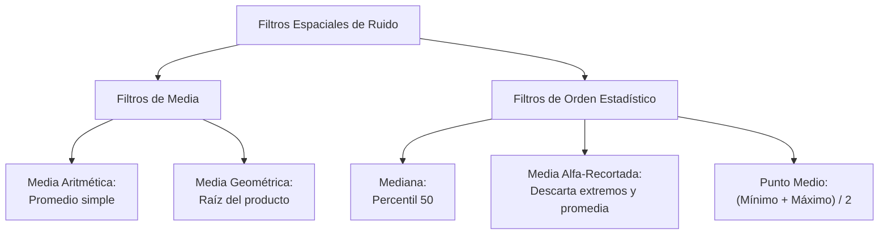

# Reducción de Ruido Aditivo y Espacial

## 🎯 Definición

En restauración de imágenes, los **filtros espaciales de reducción de ruido** operan localmente sobre una ventana de vecindad $S_{xy}$ alrededor de cada píxel $(x, y)$, estimando la señal pura subyacente $\hat{f}(x, y)$ a partir de la imagen degradada aditivamente:

$$ g(x, y) = f(x, y) + \eta(x, y) $$

A diferencia del realce (que amplifica detalles), la restauración busca **cancelar o revertir un modelo estadístico de degradación**.

---

## 🔬 Familia de Filtros de Medias y Orden Estadístico

---

### 1. Filtro de Media Aritmética
Calcula el promedio estándar de los píxeles dentro de la subimagen $S_{xy}$ de tamaño $m \times n$ ($K = m \cdot n$):

$$ \hat{f}(x, y) = \frac{1}{K} \sum_{(s, t) \in S_{xy}} g(s, t) $$

- **Propiedad estadística:** Si el ruido es Gaussiano aditivo con media cero ($E[\eta] = 0$), el promedio reduce la varianza del ruido a $\sigma^2 / K$.
- **Inconveniente:** Difumina bordes y transiciones de intensidad.

---

### 2. Filtro de Media Geométrica
Multiplica los valores de la ventana y extrae la raíz $K$-ésima:

$$ \hat{f}(x, y) = \left[ \prod_{(s, t) \in S_{xy}} g(s, t) \right]^{\frac{1}{K}} = \exp\left( \frac{1}{K} \sum_{(s, t) \in S_{xy}} \ln g(s, t) \right) $$

- **Ventajas:** Tiende a suavizar la imagen perdiendo mucho menos contraste y bordes que la media aritmética.
- **Fallo crítico:** Si el vecindario contiene **un solo píxel negro con valor 0** (por ejemplo, ruido de pimienta), todo el producto se convierte en 0, oscureciendo masivamente la zona.

---

### 3. Filtro de la Mediana
Ordena los píxeles de la ventana $g_{(1)} \le g_{(2)} \le \dots \le g_{(K)}$ y asigna el valor central:

$$ \hat{f}(x, y) = \text{mediana}_{(s, t) \in S_{xy}} \{ g(s, t) \} $$

- **Naturaleza no lineal:** No calcula sumas ni combinaciones lineales.
- **Especialidad:** **Ruido impulsivo bipolar (Sal y Pimienta)**. Los valores extremos 0 y 255 se posicionan en los extremos de la lista ordenada, quedando descartados automáticamente sin ensuciar el valor medio del vecindario.

---

### 4. Filtro de Media Alfa-Recortada (*Alpha-Trimmed Mean*)
Combina la robustez de la mediana con la reducción de varianza de la media aritmética. 

1. Se ordenan los $K$ píxeles del vecindario.
2. Se eliminan los $d/2$ píxeles más oscuros y los $d/2$ píxeles más brillantes.
3. Se promedian los $K - d$ píxeles restantes:

$$ \hat{f}(x, y) = \frac{1}{K - d} \sum_{i = \frac{d}{2} + 1}^{K - \frac{d}{2}} g_{(i)} $$

- **Comportamiento dinámico según el parámetro $d$:**
  - Si $d = 0$: se convierte exactamente en la **Media Aritmética**.
  - Si $d = K - 1$: se convierte exactamente en la **Mediana**.
  - Si $0 < d < K - 1$: es la herramienta perfecta para **escenas contaminadas simultáneamente con ruido Gaussiano y ruido impulsivo**.

---

### 5. Filtro de Punto Medio (*Midpoint Filter*)
Promedia únicamente el valor mínimo y máximo de la ventana:

$$ \hat{f}(x, y) = \frac{\min_{(s, t) \in S_{xy}} g(s, t) + \max_{(s, t) \in S_{xy}} g(s, t)}{2} $$

- **Propósito:** Excelente para **ruido con distribución uniforme**, donde el punto medio de los extremos acota fielmente el valor esperado.
- **Contraindicación:** Muy vulnerable a valores atípicos extremos.

---

## 📊 Guía de Selección Rápida

| Escenario de Ruido | Filtro Recomendado | Por qué |
| :--- | :--- | :--- |
| **Ruido Gaussiano puro** | Media Aritmética o Gaussiano | Cancela fluctuaciones de media cero |
| **Ruido Sal y Pimienta (Impulsivo)** | **Mediana** | Elimina valores atípicos sin alterar bordes |
| **Mezcla Gaussiano + Sal y Pimienta** | **Media Alfa-Recortada** | Descarta los impulsos y promedia el Gaussiano |
| **Ruido Uniforme** | **Punto Medio** | Centra la distribución simétrica de extremos |

---

## 🔗 Relacionado

- [[Filtros Notch y Rechaza Banda]] — alternativa frecuencial para ruido periódico
- [[Filtros de Suavizado Espacial]] — filtros de caja y gaussianos
- [[Dominio de la Frecuencia y Transformada de Fourier]] — espectro de Fourier
- [[2026-10-28 - Reducción de Ruido Aditivo y Cíclico]] — clase correspondiente
- [[Reducción de Ruido Aditivo y Filtros Notch - Python]] — implementación práctica
- [[Inicio]] — mapa general de la materia

---

## 🏷️ Etiquetas

#visión-artificial #procesamiento-de-imágenes #reducción-de-ruido #filtros-espaciales #ruido-gaussiano #ruido-sal-y-pimienta #media-alfa-recortada
