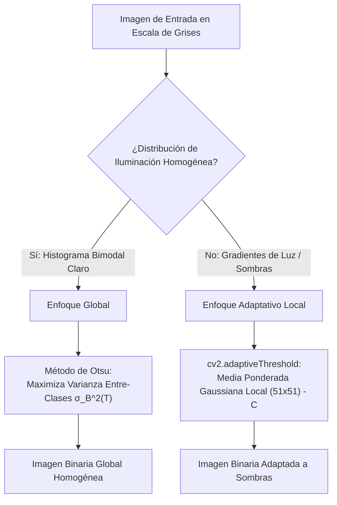

# Segmentación por Umbralización — Otsu y Adaptativo

## 🎯 Definición

La **segmentación por umbralización** (*thresholding*) es la técnica fundamental de particionamiento de imágenes que clasifica cada píxel en dos categorías mutuamente excluyentes (típicamente **objeto** y **fondo**) comparando su nivel de intensidad con uno o varios valores umbral $T$.

Existen dos estrategias principales según el comportamiento espacial de la iluminación:
1. **Umbralización Global (Fija u Otsu)**: Aplica un único valor de corte $T$ uniforme para la totalidad de la matriz de la imagen.
2. **Umbralización Adaptativa (Local)**: Calcula dinámicamente un umbral específico $T(x, y)$ para cada píxel evaluando las estadísticas locales de su vecindad espacial inmediata.

---

## 🧠 Idea clave: Umbral Global vs Iluminación Desigual

- En un escenario ideal con **iluminación uniforme** y contraste bimodal, la función de densidad de probabilidad del histograma exhibe dos picos prominentes separados por un valle profundo. Un único umbral situado en el valle separa ambos conjuntos de forma perfecta.
- En escenas industriales o biomédicas reales con **gradientes espaciales de luz, viñeteado o sombras pronunciadas**, el histograma colapsa en una distribución multimodal o monomodal ancha. Un umbral global único clasifica irremediablemente zonas de fondo en penumbra como si fueran objetos oscuros, o destruye partes del objeto sumergidas en brillos excesivos.

---

## 🧮 Desarrollo Matemático

### 1. Binarización Global Fija
Para una imagen $f(x, y)$, la máscara binaria resultante $g(x, y)$ se define según la polaridad deseada:
- **Directa (objeto claro sobre fondo oscuro)**:
  $$g(x, y) = \begin{cases} 255 & \text{si } f(x, y) \ge T \\ 0 & \text{si } f(x, y) < T \end{cases}$$
- **Inversa (objeto oscuro sobre fondo claro — `THRESH_BINARY_INV`)**:
  $$g(x, y) = \begin{cases} 255 & \text{si } f(x, y) \le T \\ 0 & \text{si } f(x, y) > T \end{cases}$$

### 2. Algoritmo de Otsu (1979)
Otsu propone una selección estadística no supervisada óptima basada en el histograma normalizado $p_i = n_i / N$:
Divide los niveles de gris $[0, L-1]$ en dos clases $C_0 = [0, T]$ y $C_1 = [T+1, L-1]$:
- Probabilidades acumuladas de clase:
  $$\omega_0(T) = \sum_{i=0}^T p_i, \qquad \omega_1(T) = \sum_{i=T+1}^{L-1} p_i = 1 - \omega_0(T)$$
- Medias de clase:
  $$\mu_0(T) = \sum_{i=0}^T \frac{i \, p_i}{\omega_0(T)}, \qquad \mu_1(T) = \sum_{i=T+1}^{L-1} \frac{i \, p_i}{\omega_1(T)}$$
- Media global: $\mu_T = \omega_0 \mu_0 + \omega_1 \mu_1$.

El umbral óptimo $T^*$ es aquel que **maximiza la varianza entre clases** $\sigma_B^2(T)$ (o equivalentemente, minimiza la varianza intra-clase $\sigma_W^2(T)$):
$$\sigma_B^2(T) = \omega_0(T) \omega_1(T) \left[ \mu_0(T) - \mu_1(T) \right]^2$$
$$T^* = \arg\max_{0 \le T < L} \sigma_B^2(T)$$

> [!note] Propiedad Estadística
> Otsu calcula el umbral óptimo desde el punto de vista estadístico de dispersión; sin embargo, no posee conocimiento semántico del contexto de la escena ni garantiza segmentación perfecta si las clases son asimétricas o no unimodales por separado.

### 3. Umbralización Adaptativa Local
En presencia de gradientes espaciales de luz, el umbral varía localmente:
$$T(x, y) = \mu_{\text{local}}(x, y) - C$$

En OpenCV (`cv2.adaptiveThreshold`):
- `blockSize`: Tamaño de la vecindad cuadrada impar (por ejemplo $51 \times 51$).
- `adaptiveMethod`:
  - `ADAPTIVE_THRESH_MEAN_C`: Promedio aritmético no ponderado de la vecindad.
  - `ADAPTIVE_THRESH_GAUSSIAN_C`: Convolución local con un núcleo Gaussiano simétrico (asigna mayor peso a los píxeles más cercanos al centro).
- $C$: Constante escalar que se resta a la media ponderada para controlar el sesgo y suprimir ruido en regiones homogéneas.

---

## 🔍 Ejemplos Numéricos de Laboratorio

### Caso 1: Imagen Sintética Bimodal Homogénea
Fondo concentrado alrededor de gris 60 y objeto alrededor de gris 180:

| Estrategia de Umbral | Valor $T$ | Exactitud Registrada |
| :--- | :---: | :---: |
| Manual cercano a la base del fondo | $70$ | $93.4\%$ |
| Manual centrado entre picos | $120$ | **$100.0\%$** |
| **Automático Otsu** | **$98$** | **$100.0\%$** |

*Conclusión*: Cuando la separación inter-clase es amplia y nítida, múltiples umbrales dentro del valle intermedio logran una precisión de clasificación del $100\%$.

### Caso 2: Manchas Circulares con Gradiente Severo de Iluminación
Escena sintética con **12 manchas circulares oscuras** ($r = 8\text{ px}$, área teórica $\pi r^2 \approx 201\text{ px}$) distribuidas sobre una superficie con una rampa luminosa no uniforme:

| Método | Componentes Conectados | Interpretación y Diagnóstico de Error |
| :--- | :---: | :--- |
| **Global Otsu** | $7$ regiones | **Falla catastrófica**: El gradiente oscuro del fondo supera el umbral global, formando una gigantesca falsa región conectada de **$43\,800\text{ px}$** que engulle y oculta varias manchas. |
| **Adaptativo Gaussiano** | **$12$ regiones** | **Éxito total**: La vecindad móvil de $51 \times 51$ compensa la rampa de luz localmente, aislando limpiamente cada una de las 12 manchas individuales. |

> [!important] La Regla del Filtrado por Área
> Jamás se debe evaluar una segmentación binaria basándose únicamente en el conteo numérico de objetos. La inspección del **área de las componentes conexas** es el filtro de seguridad crítico: una región espuria de $43\,800\text{ px}$ cuando las partículas esperadas miden $\approx 200\text{ px}$ alerta de inmediato un fallo por gradiente de iluminación.

---

## ✅ Conclusión

- La umbralización global con **Otsu** es la solución ideal, rápida y sin parámetros manuales cuando la fuente de iluminación es perfectamente homogénea o el fondo ha sido compensado previamente.
- La umbralización **adaptativa** es obligatoria en entornos no controlados con sombras o superficies curvas, debiendo calibrarse con cuidado el tamaño del bloque respecto al diámetro de las estructuras de interés y la constante de desplazamiento $C$.

---

## 🔗 Relacionado

- [[Inicio]]
- [[Histogramas y Ecualización de Imagen]]
- [[Segmentación y Cuantización por K-Medias]]
- [[Enlace Local de Bordes]]
- [[2026-11-04 - Color y Segmentación de Imágenes]]
- [[Segmentación por Bordes y Agrupamiento - Python]]

## 🏷️ Etiquetas

#visión-artificial #segmentación #umbralización #binarización #otsu #umbral-adaptativo #procesamiento-de-imágenes
