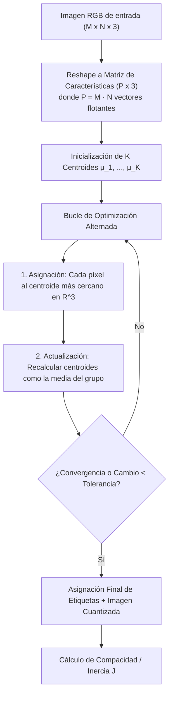

# Segmentación y Cuantización por K-Medias

## 🎯 Definición

La **segmentación por K-medias** (*K-means clustering*) es un algoritmo no supervisado de particionamiento que agrupa los píxeles de una imagen en $K$ conglomerados (*clusters*) homogéneos en función de su proximidad en un espacio de características (típicamente los canales de color [[Modelos de Color RGB y CMYK|RGB]] o [[Espacio de Color HSI y Procesamiento Cromático|HSI]]).

Al sustituir el valor de cada píxel por el vector medio (centroide) del grupo al que fue asignado, el algoritmo realiza simultáneamente una **cuantización óptima de color**, reduciendo una imagen de millones de colores posibles a una paleta fija de exactamente $K$ tonos representativos.



---

## 🧠 Idea clave: Espacio de Color vs Espacio Espacial

El algoritmo estándar de K-medias sobre imágenes procesa cada píxel como un **vector cromático independiente en $\mathbb{R}^3$**, ignorando por completo sus coordenadas espaciales $(x, y)$:
$$\vec{p}_{x, y} = \begin{bmatrix} R(x, y) \\ G(x, y) \\ B(x, y) \end{bmatrix}$$

> [!warning] La Gran Limitación: Agrupamiento Cromático ≠ Objeto Semántico
> 1. **Dispersión espacial**: Dos píxeles situados en extremos opuestos de la imagen (por ejemplo, el cielo arriba a la izquierda y un estanque abajo a la derecha) recibirán la misma etiqueta de grupo si su color azul es idéntico.
> 2. **Fragmentación por sombras**: Un mismo objeto físico con iluminación irregular o sombra propia se fragmentará en dos o más clusters diferentes, a pesar de ser topológicamente contiguo.
> 3. K-medias agrupa por **semejanza espectral**, no por **conectividad geométrica**.

---

## 🧮 Formulación Matemática y Algoritmo

Dado un conjunto de $P = M \times N$ píxeles $\mathcal{X} = \{\vec{x}_1, \vec{x}_2, \dots, \vec{x}_P\}$, el objetivo es particionar $\mathcal{X}$ en $K$ conjuntos disjuntos $S = \{S_1, S_2, \dots, S_K\}$ minimizando la función objetivo de **compacidad** o **inercia intragrupo** ($J$):

$$J = \sum_{j=1}^K \sum_{\vec{x}_i \in S_j} \|\vec{x}_i - \vec{\mu}_j\|^2$$

Donde:
- $\vec{\mu}_j$ es el vector baricentro (media) de los píxeles asignados al cluster $S_j$:
  $$\vec{\mu}_j = \frac{1}{|S_j|} \sum_{\vec{x}_i \in S_j} \vec{x}_i$$
- $\|\cdot\|$ denota la distancia euclidiana en el espacio RGB.

### Pasos del Algoritmo:
1. **Aplanamiento**: Reorganizar la matriz tridimensional $M \times N \times 3$ en un arreglo bidimensional $(M \cdot N, 3)$ en formato punto flotante `float32`.
2. **Inicialización**: Seleccionar $K$ centroides iniciales de forma aleatoria o con heurísticas inteligentes (como K-means++).
3. **Paso de Asignación (Expectation)**:
   $$S_j^{(t)} = \left\{ \vec{x}_p : \|\vec{x}_p - \vec{\mu}_j^{(t)}\|^2 \le \|\vec{x}_p - \vec{\mu}_i^{(t)}\|^2, \; \forall i, \; 1 \le i \le K \right\}$$
4. **Paso de Actualización (Maximization)**:
   $$\vec{\mu}_j^{(t+1)} = \frac{1}{|S_j^{(t)}|} \sum_{\vec{x}_p \in S_j^{(t)}} \vec{x}_p$$
5. **Criterio de Parada**: Repetir hasta que el desplazamiento de los centroides $\|\vec{\mu}_j^{(t+1)} - \vec{\mu}_j^{(t)}\| < \epsilon$ o se alcance el número máximo de iteraciones.

---

## 🔍 Ejemplos Numéricos de Laboratorio

En una imagen sintética en color procesada con distintos valores de $K$:

```python
pixeles = img_color.reshape(-1, 3).astype(np.float32)
criterio = (cv2.TERM_CRITERIA_EPS + cv2.TERM_CRITERIA_MAX_ITER, 10, 1.0)
ret, etiquetas, centros = cv2.kmeans(pixeles, K, None, criterio, 10, cv2.KMEANS_RANDOM_CENTERS)
```

| Número de Clusters ($K$) | Colores Únicos Finales | Compacidad Registrada ($J$) | Interpretación Visual |
| :---: | :---: | :---: | :--- |
| **$K = 2$** | $2$ | $\approx 1\,509\,795\,450$ | Binarización cromática grosera; mezcla objetos de tonos intermedios con el fondo. |
| **$K = 4$** | $4$ | $\approx 525\,036\,317$ | Distingue planos principales (fondo, sombra, objeto primario y reflejo). |
| **$K = 8$** | $8$ | $\approx 207\,013\,497$ | Alta fidelidad visual; preserva gradientes tonales y texturas sutiles. |

> [!note] Inercia vs Semántica
> La compacidad $J$ disminuye monótonamente conforme $K$ aumenta (en el límite trivial de $K = P$, $J = 0$). Sin embargo, una menor inercia numérica **no implica un mejor aislamiento de objetos**: un valor alto de $K$ sobre-segmenta regiones naturales y multiplica el costo computacional.

---

## ⚖️ Ventajas y Desventajas

| Ventajas | Limitaciones Críticas |
| :--- | :--- |
| Completamente no supervisado (no requiere máscaras ni etiquetas de entrenamiento). | Sensible a la inicialización aleatoria (múltiples ejecuciones pueden dar colores ligeramente distintos). |
| Fácil formulación matemática y convergencia rápida garantizada hacia un mínimo local. | Requiere fijar el parámetro $K$ de antemano (heurística del método del codo requerida). |
| Ideal para cuantización de paletas, compresión de imágenes y pre-etiquetado. | No incorpora restricciones de vecindad topológica ni conectividad espacial. |

---

## ✅ Conclusión

K-medias sobre píxeles es una técnica potente de **cuantización espectral y simplificación de imagen**. Para transformar sus agrupamientos cromáticos en una verdadera segmentación de objetos, debe complementarse con análisis de [[Segmentación por Umbralización - Otsu y Adaptativo|componentes conexas]], descriptores espaciales o incorporar las coordenadas espaciales $(x, y)$ normalizadas dentro del vector de características $(\alpha x, \alpha y, R, G, B)$.

---

## 🔗 Relacionado

- [[Inicio]]
- [[Modelos de Color RGB y CMYK]]
- [[Espacio de Color HSI y Procesamiento Cromático]]
- [[Segmentación por Umbralización - Otsu y Adaptativo]]
- [[2026-11-04 - Color y Segmentación de Imágenes]]
- [[Segmentación por Bordes y Agrupamiento - Python]]

## 🏷️ Etiquetas

#visión-artificial #segmentación #k-medias #clustering #cuantización-de-color #aprendizaje-no-supervisado #procesamiento-de-imágenes
