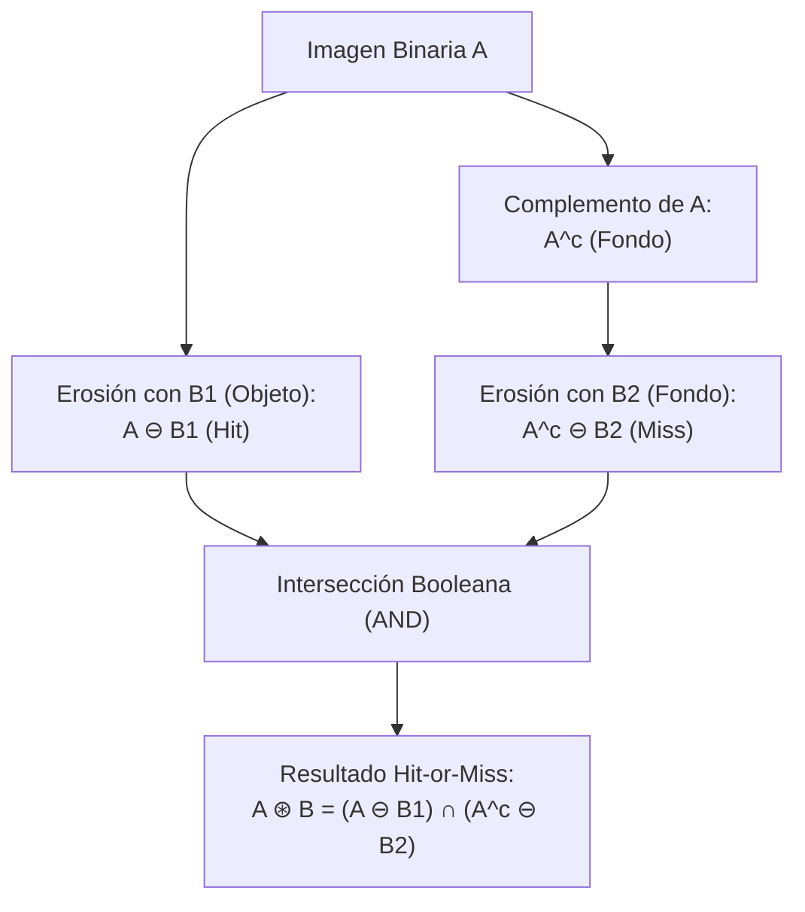

# Transformación Hit-or-Miss (Acierto o Desacierto)

## 🎯 Definición

La transformación **Hit-or-Miss** (abreviada **HMT**, o transformación *Acierto-Desacierto / Todo o Nada*), denotada por el símbolo $A \circledast B$, es una operación morfológica binaria fundamental orientada a la **detección y localización exacta de patrones geométricos específicos** dentro de una imagen binaria.

A diferencia de la erosión o la dilatación estándar que evalúan únicamente el objeto (primer plano), la transformación Hit-or-Miss evalúa **simultáneamente** la forma del objeto y la configuración del fondo circundante.

---

## 📐 1. Formulación Matemática

Sea $A$ el conjunto de píxeles del objeto (valor 1) y $A^c$ el conjunto complementario correspondiente al fondo (valor 0). 

La transformación Hit-or-Miss utiliza un elemento estructurante compuesto $B = (B_1, B_2)$, donde:
- $B_1$ es el elemento estructurante que debe **coincidir con el objeto** (*Hit* o acierto).
- $B_2$ es el elemento estructurante que debe **coincidir con el fondo** (*Miss* o desacierto).
- Condición de consistencia: $B_1 \cap B_2 = \emptyset$ (un píxel no puede ser requerido simultáneamente como objeto y como fondo).

$$A \circledast B = (A \ominus B_1) \cap (A^c \ominus B_2)$$

### Interpretación intuitiva:
1. $A \ominus B_1$ localiza todos los puntos donde la forma $B_1$ cabe dentro de la masa blanca.
2. $A^c \ominus B_2$ localiza todos los puntos donde la forma $B_2$ cabe dentro del espacio negro circundante.
3. La intersección $\cap$ conserva únicamente aquellos píxeles donde **ambas condiciones se cumplen a la vez**: se encontró el objeto exacto rodeado por el fondo exacto.

---

## 🧩 2. Representación Tri-Estado del Kernel (OpenCV)

En implementaciones prácticas (como `cv2.morphologyEx(..., cv2.MORPH_HITMISS, kernel)`), la pareja $(B_1, B_2)$ se compacta en una única matriz cuyos elementos adoptan tres posibles valores:

| Valor en Kernel | Significado | Pertenece a |
| :---: | :--- | :--- |
| **`+1`** | **Hit (Acierto)**: El píxel en la imagen DEBE ser blanco (1) | $B_1$ |
| **`-1`** | **Miss (Desacierto)**: El píxel en la imagen DEBE ser negro (0) | $B_2$ |
| **`0`** | **Don't Care**: Píxel indiferente (puede ser blanco o negro) | Exterior |

### Ejemplos de Kernels Tri-Estado ($3\times 3$):

#### A. Detección de Esquina Superior Derecha:
$$K_{\text{esquina\_SD}} = \begin{bmatrix} 0 & -1 & -1 \\ 1 & 1 & -1 \\ 0 & 1 & 0 \end{bmatrix}$$

#### B. Detección de Píxel Aislado (Ruido puntual de 1 píxel):
$$K_{\text{aislado}} = \begin{bmatrix} -1 & -1 & -1 \\ -1 & 1 & -1 \\ -1 & -1 & -1 \end{bmatrix}$$

#### C. Detección de Terminación de Línea (Punto Final / Ridge Ending):
$$K_{\text{fin\_linea}} = \begin{bmatrix} -1 & -1 & -1 \\ -1 & 1 & -1 \\ 0 & 1 & 0 \end{bmatrix}$$

---

## 📱 3. Aplicación Clave: Biometría y Huellas Dactilares

En el reconocimiento biométrico para desbloqueo de teléfonos móviles y sistemas forenses (AFIS):

### 3.1. Extracción de Minucias
Las características únicas que identifican una huella dactilar son las **minucias**:
1. **Terminaciones de cresta (*Ridge Endings*)**: Lugares donde una línea papilar termina abruptamente.
2. **Bifurcaciones (*Bifurcations*)**: Puntos donde una cresta se divide en dos ramas.

Tras adelgazar la imagen binaria de la huella a un esqueleto de 1 píxel de espesor (*thinning* morfológico), la transformación Hit-or-Miss identifica instantáneamente todas las terminaciones y bifurcaciones aplicando kernels específicos en las 8 orientaciones posibles.

### 3.2. ¿Cómo se logra la invarianza a la rotación del dedo?
Al apoyar el dedo sobre el sensor biométrico, la orientación angular puede variar entre $-180^\circ$ y $+180^\circ$. Para que el reconocimiento funcione sin importar la posición:
1. **Bancos de Kernels Rotados**: Se aplica la transformación Hit-or-Miss rotando el kernel $B$ en pasos angulares ($0^\circ, 45^\circ, 90^\circ, \dots$), uniendo los aciertos mediante la operación OR:
   $$A \circledast \{B\} = \bigcup_{k=0}^{7} (A \circledast B^{(k \cdot 45^\circ)})$$
2. **Constelaciones de Minucias Invariantes**: En lugar de comparar píxeles crudos, el procesador extrae un vector de características relativas:
   - Distancias euclidianas entre minucias vecinas (invariantes a traslación y rotación).
   - Ángulos relativos entre los triángulos formados por tripletas de minucias.
   - Conteo de crestas papilares intermedias que cruzan la línea recta entre dos minucias.

---

## 🪚 4. Esqueletización y Poda Morfológica (*Thinning & Pruning*)

A partir de Hit-or-Miss se derivan dos de los algoritmos más potentes del análisis de formas:

### 4.1. Adelgazamiento / Esqueletización (*Thinning*)
Resta a la imagen sus puntos de acierto con un banco de kernels de borde:
$$A \otimes B = A \setminus (A \circledast B)$$
Iterando este proceso hasta convergencia, se obtiene el **esqueleto topológico** que conserva la conectividad pero reduce todo el objeto a líneas de 1 píxel.

### 4.2. Poda (*Pruning*)
Elimina pequeñas ramas parásitas (*spurs*) generadas durante la esqueletización mediante la detección de puntos finales con Hit-or-Miss y su posterior eliminación controlada.

---

## 🔗 Notas Relacionadas
- [[Operaciones Morfológicas Binarias]] — Fundamentos de erosión, dilatación, apertura y cierre.
- [[2026-11-03 - Morfología Matemática en Imágenes Binarias]] — Clase teórica detallada.
- [[Morfología Matemática y Hit-or-Miss - Python]] — Laboratorio práctico y código ejecutable.
- [[Vecindad y Adyacencia de Píxeles]] — Conectividad $N_4$ y $N_8$ en retículos discretos.
- [[Inicio]] — Hub principal de la asignatura.
