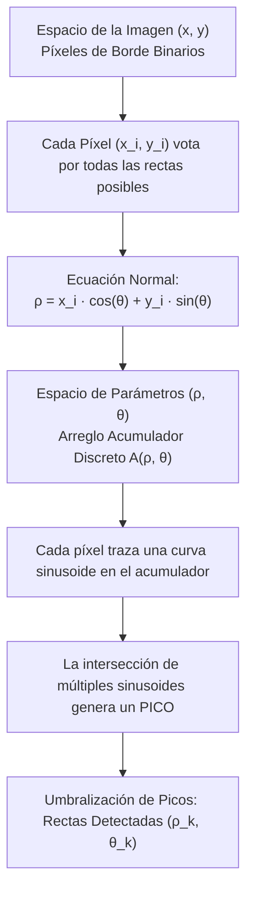

# Transformada de Hough

## 🎯 Definición

La **Transformada de Hough** es un método global de reconocimiento de patrones geométricos que detecta formas paramétricas simples (como rectas, círculos o elipses) mediante un **mecanismo de votación en un espacio de parámetros discretizado (acumulador)**.

A diferencia de los enfoques locales como el [[Enlace Local de Bordes|enlace de bordes]] (que exigen adyacencia espacial continua), la Transformada de Hough es capaz de identificar alineaciones globales aun cuando los contornos se encuentren **severamente fragmentados, ocluidos o contaminados por ruido**.



---

## 🧠 Idea clave: De Pendiente-Intersección a la Forma Normal

La ecuación clásica de una recta en el plano cartesiano es:
$$y = m x + b$$
Sin embargo, esta formulación presenta una **falla computacional insalvable**: para rectas verticales, la pendiente $m \to \infty$ y la intersección $b \to \infty$, requiriendo un espacio de acumulación no acotado.

### La Representación Normal de Duda y Hart (1972)
Para resolver la singularidad vertical, se representa la recta mediante sus coordenadas polares normales:
$$\rho = x \cos \theta + y \sin \theta$$

Donde:
- $\rho \in [-\rho_{\max}, \rho_{\max}]$: Distancia perpendicular con signo desde el origen de coordenadas hasta la recta.
  $$\rho_{\max} = \sqrt{M^2 + N^2} \quad \text{(diagonal de la imagen)}$$
- $\theta \in [0, \pi)$ o $[-90^\circ, 90^\circ]$: Ángulo que forma el vector normal a la recta con respecto al eje horizontal $x$.

> [!important] Convención Geométrica de Orientación
> Con la formulación $\rho = x \cos \theta + y \sin \theta$:
> - $\theta \approx 0^\circ$ ($0\text{ rad}$): Recta **vertical** ($\rho = x$).
> - $\theta \approx 90^\circ$ ($\pi/2\text{ rad}$): Recta **horizontal** ($\rho = y$).

---

## 🧮 Desarrollo Matemático y Algoritmo

### 1. Dualidad Punto-Línea y Curvas Sinusoidales
1. Un punto $(x_i, y_i)$ fijo en el espacio de la imagen define una curva **sinusoidal** en el espacio $(\rho, \theta)$:
   $$\rho(\theta) = x_i \cos \theta + y_i \sin \theta$$
2. Si un conjunto de $K$ puntos colineales pertenecen a la misma recta con parámetros $(\rho_0, \theta_0)$, sus respectivas curvas sinusoidales en el plano $(\rho, \theta)$ se **cruzarán exactamente en el punto común $(\rho_0, \theta_0)$**.

### 2. Discretización y Acumulador
El espacio continuo $(\rho, \theta)$ se cuantiza en una matriz bidimensional de celdas acumuladoras $A[\rho_j, \theta_k]$:
- Resolución angular: $\Delta \theta$ (típicamente $1^\circ = \pi / 180\text{ rad}$).
- Resolución de distancia: $\Delta \rho$ (típicamente $1\text{ píxel}$).

### 3. Procedimiento de Ejecución:
1. Inicializar el arreglo acumulador en ceros: $A[\rho, \theta] = 0$.
2. Extraer los píxeles de borde de la imagen mediante [[Derivadas Espaciales en Imágenes|Sobel]] o Canny.
3. Para cada píxel de borde $(x_i, y_i)$:
   - Variar $\theta$ desde $\theta_{\min}$ hasta $\theta_{\max}$ en pasos de $\Delta \theta$.
   - Calcular $\rho = x_i \cos \theta + y_i \sin \theta$.
   - Incrementar la celda correspondiente: $A[\rho, \theta] \leftarrow A[\rho, \theta] + 1$.
4. Identificar las celdas $A[\rho, \theta]$ cuyos votos superen un umbral predefinido $T_{\text{votos}}$ y aplicar supresión de no-máximos local para fusionar picos adyacentes.

---

## 🔍 Ejemplos Numéricos de Laboratorio

En una prueba controlada con una imagen de un rectángulo sintético cuyos cuatro lados fueron perforados con múltiples huecos y discontinuidades periódicas:

```python
lineas = cv2.HoughLines(imagen_perforada, rho=1, theta=np.pi / 180, threshold=80)
```

- **Detecciones iniciales**: El acumulador registró **16 detecciones** por encima del umbral de 80 votos (debido a la dispersión de votos en celdas vecinas).
- **Consolidación de rectas**: Al agrupar líneas cercanas mediante supresión de picos, el algoritmo aislador recuperó con exactitud las **cuatro rectas maestras** delimitadoras del rectángulo:
  - Rectas verticales: $x \approx 50$ y $x \approx 150$.
  - Rectas horizontales: $y \approx 50$ y $y \approx 150$.

> [!note] Modelo Geométrico vs Interpolación de Píxeles
> La Transformada de Hough detecta la **ecuación paramétrica** que explica la disposición de los puntos sobrevivientes; **no reconstruye los píxeles faltantes** en la matriz de la imagen. Las líneas continuas que se superponen son una representación gráfica del modelo analítico ajustado.

---

## ⚖️ Comparativa: Enlace Local vs Transformada de Hough

| Criterio | [[Enlace Local de Bordes]] | Transformada de Hough (Rectas) |
| :--- | :--- | :--- |
| **Evidencia principal** | Vecindad espacial contigua, magnitud y orientación local compatibles. | Votos acumulados globales de píxeles mutuamente alineados. |
| **Requisito de conectividad** | Obligatorio: requiere una cadena ininterrumpida de candidatos. | Innecesario: conecta fragmentos dispersos y salta grandes huecos. |
| **Tipo de salida** | Mapa binario de píxeles de borde enlazados. | Parámetros matemáticos analíticos $(\rho, \theta)$. |
| **Flexibilidad morfológica** | Sigue contornos curvos arbitrarios y sinuosos. | Restringido al modelo formulado (rectas; requiere variantes para elipses/círculos). |
| **Sensibilidad al ruido** | Si el ruido está cerca de un borde, puede propagarlo erróneamente. | Muy robusto: el ruido aleatorio dispersa votos sin crear picos concentrados. |

---

## ✅ Conclusión

La Transformada de Hough es el estándar clásico para la inferencia de primitivas geométricas globales. Al trasladar el problema de detección desde el dominio espacial local hacia un espacio de parámetros de votación global, supera de forma elegante las limitaciones de oclusión, desvanecimiento de borde y discontinuidades severas en aplicaciones de detección de carriles vehiculares, fachadas urbanas y metrología industrial.

---

## 🔗 Relacionado

- [[Inicio]]
- [[Enlace Local de Bordes]]
- [[Derivadas Espaciales en Imágenes]]
- [[Operadores de Gradiente - Roberts, Prewitt y Sobel]]
- [[2026-11-04 - Color y Segmentación de Imágenes]]
- [[Segmentación por Bordes y Agrupamiento - Python]]

## 🏷️ Etiquetas

#visión-artificial #detección-de-bordes #transformada-de-hough #detección-de-rectas #segmentación #geometría-computacional
